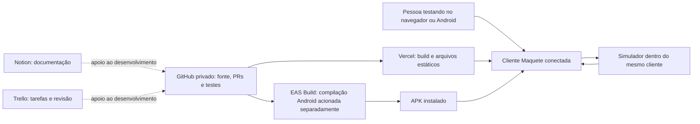
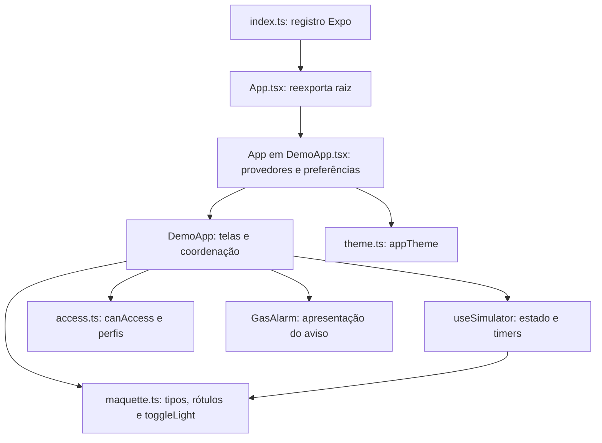
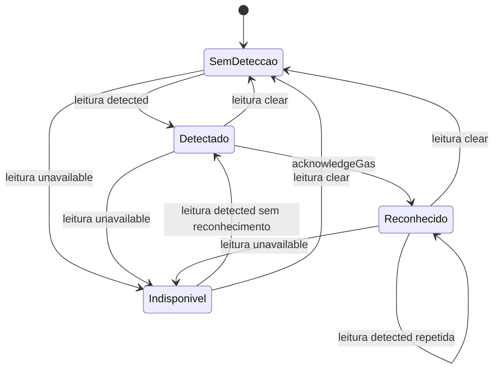
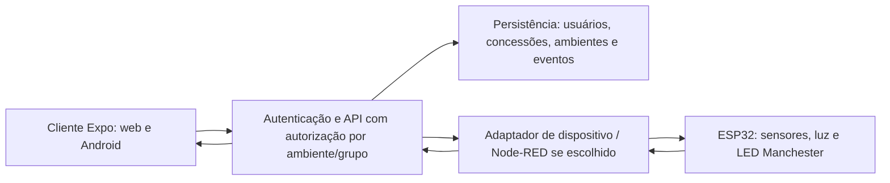

> **Registro histórico.** Instruções e resultados da etapa original; não é o guia operacional atual. Consulte [arquitetura.md](arquitetura.md) e o [índice atual](README.md).

# Documentação de Arquitetura de Software — Maquete conectada

> Registro histórico da base v0.3.0. A candidata v0.4.0 (SAMAHI) altera a interface, introduz catálogo e estado de simulação por ambiente e remove Evidências da navegação. Consulte [arquitetura e validação do redesign](redesign-stitch-samahi.md) para essas diferenças. Este documento não deve ser usado isoladamente para descrever a nova interface.

## 1. Identificação e como usar

**Sistema:** aplicativo de controle e acompanhamento da maquete, desenvolvido por César. **Versão implementada:** 0.3.0. **Base inspecionada:** commit `47398c12e51d0517f9adf4413841a81d83366818`, main após os PRs #4 e #5. A arquitetura descrita é a dessa base; alterações posteriores precisam de atualização deste documento.

Esta é uma descrição da implementação e um material de estudo. A monografia, a montagem física e o firmware de Gabriel são frentes relacionadas, mas seus códigos não estão neste repositório. Não há informação suficiente aqui para documentar pinagem, circuito elétrico ou firmware como se já existissem.

Leia primeiro as seções 2 a 7 para entender o conjunto; depois acompanhe os fluxos de luz, gás e permissões. Use o [Manual de manutenção e estudo](manual-desenvolvimento.md) para editar e explicar o código. A documentação técnica versionada no GitHub é a referência de manutenção; as páginas do Notion são cópias de consulta e devem registrar a mesma revisão.

**Legenda:** “implementado” significa presente no código; “validado” exige um registro de teste; “proposto” descreve trabalho futuro. Um diagrama proposto não comprova integração.

## 2. Resumo do sistema atual

O sistema atual é um **cliente Expo/React Native com simulação em memória**, distribuído como site estático no Vercel e como APK Android pelo EAS Build. A interface usa o mesmo código nos dois destinos, com composição diferente conforme a largura da tela.

O aplicativo permite escolher um perfil fictício, consultar sensores, controlar iluminação, selecionar a cor Manchester manualmente, consultar eventos e demonstrar a administração de conexões e permissões. O estado pertence à instância do aplicativo: dois colegas abrindo o site não controlam uma mesma sala compartilhada.

| Parte | Situação nesta base |
| --- | --- |
| Iluminação, intensidade e retorno de comandos | Implementados com confirmação simulada |
| Temperatura e umidade | Valores fixos de exemplo; horário de recebimento simulado |
| Detecção de gás e reconhecimento | Estados fictícios injetados pela Conta |
| Indicador externo Manchester | Seleção manual simulada, independente de gás |
| Contas e concessões | Perfis locais, sem autenticação |
| Configuração/teste de conexão | Formulário e teste local, sem requisição ao endereço |
| Histórico | Até 30 eventos em memória |
| Site Vercel e APK | Distribuição do cliente; não constituem backend |
| API, banco de dados, Node-RED, MQTT, ESP32 | Não implementados neste repositório |
| Fechadura, vários ambientes, borda pulsante | Expansões; não funcionam nesta entrega |

O aplicativo demonstra uma interface de automação. Não executa classificação clínica, não identifica toxicidade e não é um sistema de segurança hospitalar validado.

## 3. Vocabulário para ler o código

| Termo | Significado neste projeto |
| --- | --- |
| Componente | Função que descreve uma parte da interface; exemplos: Panel e GasAlarm |
| Props | Valores e funções recebidos pelo componente; GasAlarm recebe onClose |
| Estado / state | Valor lembrado pelo React entre renderizações; muda com seu setter |
| Renderização | Nova avaliação da interface a partir do estado atual |
| Hook | Função React iniciada por use; useSimulator agrupa a simulação |
| Função pura | Calcula um resultado sem alterar o objeto recebido ou acessar a interface |
| Ref | Referência mutável lembrada entre renderizações; sua mudança não redesenha a tela |
| Callback | Função executada depois de um evento ou prazo |
| Telemetria | Dados reportados pelo dispositivo; aqui são representados por DeviceState fictício |
| Confirmação / acknowledgement de comando | Retorno de que a alteração foi aplicada; aqui um timer simula esse retorno |
| Reconhecimento de alerta | Registro de que alguém viu o alerta; não significa que o gás desapareceu |
| Build / compilação | Preparação de arquivos distribuíveis |
| Deploy / publicação | Disponibilização de um build em um serviço |
| Backend | Serviço que processaria operações fora do cliente; ainda ausente |
| Endpoint | Endereço de um serviço; o campo atual é apenas configuração demonstrativa |

A noção de estado e setters é explicada pela [documentação do React](https://react.dev/learn/state-a-components-memory). O uso de refs está descrito na [referência useRef](https://react.dev/reference/react/useRef). Os exemplos deste documento descrevem o código próprio do projeto.

## 4. Contexto e fronteiras



GitHub, Notion e Trello são ferramentas do desenvolvimento, não serviços chamados pelo aplicativo durante seu uso. Vercel entrega HTML, JavaScript, fontes e outros arquivos. EAS compila o pacote Android. Nenhum desses vínculos cria comunicação com a maquete automaticamente.

**Responsabilidades da equipe:** César: app, arquitetura e interfaces de comunicação; Gabriel: hardware e firmware; Matheus: monografia; todos apoiam e revisam. O contrato de integração deve ser acordado entre César e Gabriel antes de implementar a comunicação.

## 5. Tecnologias e papel de cada uma

Valores declarados no [package.json](../package.json), não uma recomendação de instalar “a versão mais recente”.

| Tecnologia | Declaração no projeto | Responsabilidade |
| --- | --- | --- |
| Expo | ~57.0.26 | Ambiente, desenvolvimento, empacotamento e exportação web |
| React | 19.2.3 | Componentes, estado, efeitos e atualização da interface |
| React Native | 0.86.3 | View, Text, ScrollView, Animated, Modal e demais primitivas |
| React DOM | 19.2.3 | Suporte à execução web |
| React Native Web | ^0.21.2 | Adaptação das primitivas React Native ao navegador |
| React Native Paper | ^5.15.3 | Cartões, botões, campos, diálogos, navegação e tema MD3 |
| Expo Vector Icons | ^15.1.1 | Ícones MaterialCommunityIcons |
| Community Slider | 5.2.0 | Controle de intensidade |
| Safe Area Context | ~5.7.0 | Área segura em dispositivos com recortes/barras |
| Expo Status Bar | ~57.0.1 | Aparência da barra de status |
| TypeScript | ~6.0.3 | Tipagem estática; strict ativado |
| tsx | ^4.23.15 | Executar os testes TypeScript no Node |
| Node test/assert | Módulos nativos | Asserções e execução dos oito testes |
| ESLint / configuração Expo | ^9.39.5 / ~57.0.2 | Conferência de padrões e problemas de código |
| Prettier | ^3.9.9 | Ferramenta disponível; sem script de formatação próprio |
| Node.js | 24 no CI | Instalação, ferramentas e validação; não servidor de produção |

`package-lock.json` fixa a resolução instalada. `npm ci` usa esse arquivo; alterar dependências exige atualizar o lock de forma compatível. TypeScript ajuda durante o desenvolvimento, mas seus tipos não validam automaticamente JSON vindo de uma futura API. [Fonte: opção strict](https://www.typescriptlang.org/tsconfig/strict.html).

## 6. Estrutura e estilo arquitetural

A separação atual é simples: **apresentação + coordenação da simulação + regras de domínio**. Há responsabilidades de aplicação dentro de DemoApp. Não se trata de uma implementação completa de Clean Architecture, MVC, DDD ou microserviços.

```text
index.ts
App.tsx
src/
  domain/
    maquette.ts      tipos e transições da maquete
    access.ts        perfis e regras de concessão
  hooks/
    useSimulator.ts  estado, timers, confirmação e histórico
  ui/
    DemoApp.tsx      raiz visual, telas, administração e navegação
    GasAlarm.tsx     janela e animações do alerta
    theme.ts         paletas e configuração do Paper
tests/
  maquette.test.ts   quatro testes
  access.test.ts     dois testes
  gas.test.ts        dois testes
docs/               arquitetura, registros, fontes e capturas
.github/            CI, modelo de PR e formulário de defeitos
assets/             ícones e arquivos de identidade do pacote
```



As setas representam dependências de módulos. As regras de domínio não importam React nem a interface, o que permite testá-las separadamente. GasAlarm recebe callbacks e não importa o simulador. O hook importa as regras, mas não sabe quais perfis podem controlá-lo; essa autorização fica no coordenador visual.

### Mapa de arquivos e pontos de entrada

| Arquivo | O que procurar | Papel |
| --- | --- | --- |
| [index.ts](../index.ts) | registerRootComponent | Registra o componente para Expo |
| [App.tsx](../App.tsx) | export default | Ponte de entrada; não contém mais as telas |
| [DemoApp.tsx](../src/ui/DemoApp.tsx) | App, DemoApp, send, setLevel, addUser, testConnection | Coordenação e telas |
| [theme.ts](../src/ui/theme.ts) | appTheme | Paletas e redução de animações Paper |
| [GasAlarm.tsx](../src/ui/GasAlarm.tsx) | closeAlarm, strip, Animated.loop | Aviso e saída |
| [maquette.ts](../src/domain/maquette.ts) | initialState, applyCommand, connectionState | Estado e regras da maquete |
| [access.ts](../src/domain/access.ts) | initialUsers, canAccess, emptyGrants | Perfis e permissões |
| [useSimulator.ts](../src/hooks/useSimulator.ts) | send, selectScenario, reset, cancelPending | Simulação temporal |
| [app.json](../app.json) | version, android, extra.eas | Configuração Expo e identificação do pacote |
| [eas.json](../eas.json) | build.preview | Distribuição interna em APK |
| [vercel.json](../vercel.json) | buildCommand, outputDirectory | Build estático |
| [ci.yml](../.github/workflows/ci.yml) | validate | Verificações de PR e main |
| [tsconfig.json](../tsconfig.json) | strict | Opções de TypeScript |
| [eslint.config.js](../eslint.config.js) | expoConfig | Padrões de lint |

Para referências estáveis, os mesmos arquivos podem ser consultados no [snapshot do código inspecionado](https://github.com/Cesarcfw/tcc-maquete-app/tree/47398c12e51d0517f9adf4413841a81d83366818). O repositório é privado; colegas precisam de acesso.

## 7. Inicialização e ciclo de vida

1. Expo usa index.ts como entrada, conforme package.json.
2. index.ts importa App.tsx e chama registerRootComponent.
3. App.tsx exporta o componente padrão de src/ui/DemoApp.tsx.
4. Esse componente, chamado App dentro do arquivo, cria preferências de tema e movimento.
5. SafeAreaProvider e PaperProvider envolvem DemoApp. O Paper recebe o tema e o resolvedor de ícones.
6. DemoApp monta useSimulator, os perfis iniciais e a configuração de conexão.
7. Como session começa null, a escolha de perfis aparece.
8. Entrar como alguém muda session, cancela comandos pendentes e abre Painel.
9. Alterações de estado fazem o React recalcular a interface.
10. Ao desmontar, efeitos limpam os timers e a assinatura de acessibilidade.

O simulador já está montado na tela de escolha de perfis. Trocar perfil não recria o estado do dispositivo: luz, gás, histórico e permissões alteradas continuam nessa instância. Recarregar a página ou iniciar uma nova instância recria os valores padrão.

O código usa `useState` para o que aparece na interface; `useRef` para timers, travas e geração de comandos; `useEffect` para intervalos/animações/assinaturas; `useMemo` para construir o tema a partir das preferências. A limpeza dos efeitos segue o modelo descrito em [useEffect](https://react.dev/reference/react/useEffect).

## 8. Modelo de dados e propriedade do estado

### 8.1 DeviceState

Declarado em maquette.ts. Um único objeto representa o estado confirmado da maquete.

| Campo | Tipo | Inicial | Significado |
| --- | --- | --- | --- |
| temperature | number | 24.6 | Temperatura fictícia em °C |
| humidity | number | 58 | Umidade fictícia em % |
| gas | clear / detected / unavailable | clear | Estado de detecção |
| gasAcknowledged | boolean | false | Reconhecimento da ocorrência atual |
| receivedAt | number | Date.now() | Timestamp de recebimento em ms |
| lightOn | boolean | true | Estado confirmado da luz |
| intensity | number | 65 | Intensidade confirmada 0–100 |
| lastPositiveIntensity | number | 65 | Intensidade usada ao religar |
| indicator | IndicatorColor | blue | Cor Manchester ou off |

Não há ID do dispositivo dentro de DeviceState, nem cadastro de pacientes. A associação ao ambiente é única e fixa no cliente.

### 8.2 Command e estados enumerados

```typescript
type Command =
  | { kind: "light"; on: boolean; intensity: number }
  | { kind: "indicator"; color: IndicatorColor };
```

`kind` distingue as operações. Não existe comando para temperatura, umidade ou gás: são dados de leitura; a injeção de gás na Conta é uma ferramenta do simulador.

`Scenario`: normal, offline, stale, timeout. `IndicatorColor`: red, orange, yellow, green, blue, off. `GasStatus`: clear, detected, unavailable. Strings internas em inglês têm rótulos em português; alterar um rótulo não requer alterar a chave técnica.

### 8.3 DemoUser e concessões

`DemoUser` contém id, name, email, admin e grants. A estrutura é `grants[environmentId][group] = level`. O ID fixo é `quarto-01`; nome da sala e identificação demonstrativa ESP32 podem mudar sem mudar esse ID.

Grupos: light, sensors, indicator, history. Níveis: none, read, control. O booleano admin habilita administração; não substitui as concessões de cada grupo.

### 8.4 Propriedade e duração

| Estado | Onde fica | Quando desaparece |
| --- | --- | --- |
| device, scenario, pending, notice, logs, now | useSimulator | Desmontagem ou reset parcial da simulação |
| users e grants | DemoApp | Desmontagem/recarregamento; reset da simulação preserva |
| session e screen | DemoApp | Desmontagem; troca de perfil redefine tela/sessão |
| connection | DemoApp | Desmontagem; reset preserva campos e reativa |
| draft da luz | DemoApp | Navegação, envio, troca de perfil/cenário e reset |
| connectionDraft, name, email, formError, testStatus | DemoApp | Edição/fechamento dos formulários; sem armazenamento externo |
| dark, reduceMotion, systemReduced | App em DemoApp.tsx | Desmontagem; troca de perfil preserva |
| gasOverlayClosed | DemoApp | Desmontagem; troca de perfil redefine false |
| motion, exit, closing | GasAlarm | Desmontagem da janela |

Atualizações usam cópias dos objetos, como `{ ...state, indicator: command.color }`, e setters funcionais quando dependem do valor anterior. Alterar diretamente uma propriedade não é o fluxo adotado.

## 9. Fluxo de iluminação e confirmação

### 9.1 Da intenção ao estado reportado

```mermaid
sequenceDiagram
  actor U as Pessoa
  participant UI as DemoApp
  participant ACC as canAccess
  participant SIM as useSimulator
  participant DOM as applyCommand
  U->>UI: Ajusta e solta slider ou toca atalho
  UI->>ACC: Pode controlar light em quarto-01?
  ACC-->>UI: Sim ou não
  UI->>UI: Conferir ready
  UI->>SIM: send(command, nome)
  SIM->>SIM: busy=true, pending=true, log solicitado
  Note over UI,SIM: Valor confirmado anterior permanece
  alt normal
    SIM->>SIM: Aguardar 650 ms e conferir geração
    SIM->>DOM: applyCommand(estado anterior, comando)
    DOM-->>SIM: Novo estado
    SIM-->>UI: pending=false, confirmado, log
  else timeout
    SIM->>SIM: Aguardar 5 s
    SIM-->>UI: Falha; manter estado anterior
  end
```

O slider guarda `draft` durante o arraste e envia em `onSlidingComplete`. O número principal continua exibindo a intensidade confirmada; um texto distingue o ajuste em edição. Atalhos enviam 0, 25, 50 ou 100. O switch usa toggleLight.

A função send da UI verifica concessão e `ready = online && connection.active && !pending`. A função send do hook também verifica busy e estado online. A segunda verificação evita duas solicitações antes de o React redesenhar os controles, mas não faz autorização de usuário.

### 9.2 Regras de applyCommand

- Intensidade precisa ser inteira e estar entre 0 e 100; valores inválidos lançam Error.
- `on: false` resulta em intensidade zero.
- `on: true, intensity: 0` também resulta em luz desligada.
- Valor positivo liga e atualiza lastPositiveIntensity.
- Desligar preserva lastPositiveIntensity.
- Religando, toggleLight usa o último valor positivo; se ele for falsy, usa 100.
- Comandos de luz preservam sensores, gás e Manchester.
- Validação de indicador depende dos tipos/valores da interface; applyCommand não faz validação runtime completa da cor.

Exemplo real: 65 → comando 25 confirmado → apagar → religar: retorna a 25. Se o comando 100 falha, o confirmado permanece 25.

### 9.3 Cancelamento e concorrência

`generation.current` é um contador. Cada comando captura sua geração. Trocar cenário, resetar, cancelar por troca de sessão ou alterar permissões incrementa o contador e limpa o timeout. Mesmo que um callback antigo chegue a executar, ele compara a geração e não aplica o comando cancelado.

Não há fila de comandos, repetição automática ou reaplicação na reconexão. `busy.current` é a trava imediata; `pending` é o estado visual. `sequence.current` identifica eventos, não serve como commandId de uma API.

## 10. Sensores, conexão e cenários

O intervalo do hook roda a cada 1.000 ms. Atualiza now em todos os cenários e receivedAt apenas em normal e timeout. Temperatura e umidade permanecem 24,6 °C e 58%. Um timestamp renovado aqui é simulação de comunicação, não medição física.

`connectionState` retorna offline quando o cenário é offline; caso contrário, stale se `now - receivedAt >= 10000`, e online abaixo desse limite.

| Cenário | Telemetria simulada | Comando | Último estado |
| --- | --- | --- | --- |
| normal | Timestamp renova | Confirma em 650 ms | Atualiza após confirmação |
| offline | Timestamp não renova | Bloqueado | Preservado |
| stale | Entrar define receivedAt como agora − 18 s | Bloqueado | Preservado |
| timeout | Timestamp renova | Falha em 5 s | Preservado |

Os tempos são parâmetros de demonstração. Timers do navegador e do sistema podem atrasar; não são garantia de tempo real. receivedAt usa relógio local, não relógio sincronizado do ESP32.

A UI combina o estado do hook com connection.active. Desativar pela administração marca active=false e seleciona offline, cancelando comandos. Reativar marca active=true e seleciona normal. Esta configuração é de sessão.

## 11. Gás: domínio, reconhecimento e apresentação

### 11.1 Transições do domínio

`applyGasReading` altera gas e redefine reconhecimento, exceto quando o estado anterior e o novo são ambos detected: nessa repetição preserva gasAcknowledged. `acknowledgeGas` só reconhece se há detecção.



Reconhecido ainda significa `gas === detected`. Normalizar ou ficar indisponível zera reconhecimento. Uma nova detecção depois disso exige reconhecer novamente. Nenhuma dessas operações altera indicator.

simulateGas injeta um estado no hook se a conexão simulada está online, atualiza receivedAt e cria evento. A UI só oferece a injeção quando há leitura de sensors e ready. Isso não representa concessão de controle de sensor físico.

### 11.2 Quando o aviso aparece

DemoApp monta GasAlarm quando existe perfil com leitura de sensors, gas é detected e `!gasAcknowledged || !gasOverlayClosed`.

- Detecção nova abre o aviso, mesmo que uma ocorrência anterior tenha sido fechada.
- Reconhecer mantém a janela aberta e a detecção ativa.
- Voltar fecha a janela, mantendo os dados.
- “Ver alerta de gás” define gasOverlayClosed=false e permite reabrir.
- Trocar perfil redefine a preferência de fechamento. Quem não tem leitura de sensors não vê o aviso.
- Offline não transforma detecção anterior em clear; a janela informa que a leitura atual está indisponível.

### 11.3 Animações e estrutura de GasAlarm

GasAlarm usa Modal transparente com entrada fade; ScrollView mantém o conteúdo acessível em telas baixas. A faixa tem largura 100%, barras superior/inferior de 28 px e conteúdo central até 820 px.

As listras são View pretas com inclinação de −30°. Uma Animated.Value percorre 0→1 em 3.000 ms, Easing.linear, com loop infinito. As barras transladam em sentidos opostos por um período de 80 px; há listras extras para cobrir as bordas.

Após reconhecer, closeAlarm bloqueia cliques repetidos por closingRef e closing. Uma animação de 380 ms leva translateX de 0 à largura da tela e reduz a opacidade do fundo de 1 a 0. onClose só é chamado ao concluir. Redução de movimentos desativa o loop e fecha imediatamente.

As animações do aviso usam useNativeDriver=false. A ilustração de luz em Room usa opacidade, 350 ms e useNativeDriver=true; com movimentos reduzidos usa duração zero. O uso de Animated é descrito na [documentação React Native](https://reactnative.dev/docs/animated). Não foi realizado estudo de desempenho nativo para escolher ou otimizar o driver.

O aviso fala em possível gás/fumaça, tipo não identificado. Sem hardware e calibração, não existem ppm, porcentagem de risco, identificação química ou gradação “comum/tóxico” implementadas.

## 12. Manchester: função e independência

maquette.ts mantém colorNames e indicatorPriorities; DemoApp.tsx mantém indicatorColors, que são cores visuais hexadecimais da interface.

| Chave | Rótulo | Prioridade |
| --- | --- | --- |
| red | Vermelho | Emergente |
| orange | Laranja | Muito urgente |
| yellow | Amarelo | Urgente |
| green | Verde | Pouco urgente |
| blue | Azul | Não urgente |
| off | Desligado | Apagar indicador; sem categoria exibida |

O comando indicator altera apenas indicator. Os sensores não determinam a triagem. O aplicativo sinaliza manualmente uma classificação definida fora dele; não calcula classificação de paciente.

A relação entre cores/prioridades está documentada em [manchester.md](manchester.md), com a [nota técnica do GBCR](https://www.gbcr.org.br/wp-content/uploads/2024/07/Nota-Tecnica-GBCR-Pais-preocupados-mal-estar.pdf). Esta referência sustenta o significado das cores; as regras de simulação e a independência do gás são decisões deste projeto.

## 13. Perfis, autorização e limites de segurança

### Matriz inicial em quarto-01

| Perfil | Admin | Iluminação | Sensores | Manchester | Histórico |
| --- | --- | --- | --- | --- | --- |
| César | Sim | Controlar | Visualizar | Controlar | Visualizar |
| Gabriel | Não | Controlar | Visualizar | Controlar | Visualizar |
| Matheus | Não | Visualizar | Visualizar | Sem acesso | Visualizar |
| Novo perfil criado | Não | Sem acesso | Sem acesso | Sem acesso | Sem acesso |

canAccess resolve concessão ausente como none. Read aceita read ou control. Control exige control, exceto sensors/history, que sempre recusam control, inclusive se um objeto malformado tiver essa concessão. Admin não ganha acesso automático ao dispositivo.

DemoApp verifica user.admin para Conexões/Usuários, setLevel, addUser, testConnection e alterações administrativas. A navegação e o conteúdo de tela também têm verificações. A matriz edita apenas o ambiente fixo, cancela comandos pendentes e muda imediatamente users em memória.

addUser exige nome não vazio, formato de e-mail e ausência de duplicata após trim/minúsculas. Gera id demo-N, admin=false e emptyGrants. Não envia convite, não cria login nem confirma o e-mail. Não há UI para promover admin, excluir usuário ou recuperar senha.

**Fronteira de segurança atual:** tudo acontece no cliente. Qualquer visitante pode selecionar César. O bundle contém os perfis de exemplo e o estado está em memória. Há verificações de interface e coordenação, mas não autenticação/autorização confiáveis contra adulteração do cliente.

O histórico permitido mostra os eventos do ambiente de todos os perfis dessa sessão, sem filtro por autor. notice é global e aparece no painel de conexão/Conta; pode incluir texto de comandos mesmo quando um grupo está restrito. Logo, o protótipo não garante sigilo por grupo. Não inserir dados reais de pacientes, credenciais ou informações privadas nos perfis de demonstração.

## 14. Administração da conexão

connection contém name, device, endpoint e active. Valores iniciais: Quarto da maquete, ESP32-quarto-01, https://servico.exemplo, true. A UI apresenta um único ambiente.

Fluxo: administrador abre Editar e testar → campos alimentam connectionDraft → testConnection valida os campos → timer de 700 ms gera passed/failed → Salvar fica disponível quando passed → copia os campos tratados para connection.

O teste aceita http/https, exige ambiente/dispositivo e rejeita username/password embutidos na URL. Não testa DNS, TLS, rota, credencial, HTTP ou capacidade do ESP32. O resultado do timer usa o estado de conexão simulado capturado ao iniciar o teste.

Editar campo redefine testStatus para idle; fechar diálogo limpa o timer e erros. Como o formulário ainda simula a operação, a invalidação de um teste iniciado antes de uma edição/troca de cenário precisa de revisão antes da integração real: o callback pode concluir com uma informação capturada anteriormente. Isso é uma observação de leitura do código, não resultado de teste automatizado.

Salvar não substitui o simulador, não conecta ao endpoint e não cadastra outro environmentId. O identificador device é texto demonstrativo, não descoberta de equipamento.

## 15. Telas, responsividade, tema e acessibilidade

| Tela | Conteúdo | Controle de acesso |
| --- | --- | --- |
| Escolha de perfil | Introdução e perfis fictícios | Sem autenticação |
| Painel | Ilustração, conexão, luz, sensores, gás, Manchester | Cartões e controles por grupo |
| Histórico | Eventos recentes da sessão | read(history) |
| Conta | Perfil, concessões, aparência, laboratório e atalhos | Perfil atual; administração e reset para admin |
| Conexões | Editar/testar/ativar/desativar | admin |
| Usuários | Seleção, matriz e criação de perfil | admin |
| Evidências | Roteiro de prints/vídeos e limites | Perfil selecionado |

Screen é uma união de strings. navigate muda screen, limpa draft e rola ao topo. Não há Expo Router, React Navigation, rotas de URL, deep links ou histórico de navegação implementados. BottomNavigation.Bar desenha a barra; não é um roteador. A tecla/gesto Voltar nativo não tem aqui uma pilha própria de telas; Modal trata onRequestClose pelo closeAlarm.

Breakpoints: abaixo de 760 px, cartões empilhados; a partir de 760 px, colunas; a partir de 1100 px, menu lateral de 260 px. A página central tem maxWidth 1220 px. Abaixo de 1100 px, três abas inferiores: Ambiente, Histórico, Conta. Administração/Evidências são alcançadas pelos botões de Conta; essas telas mantêm a aba Conta selecionada.

Panel padroniza Card/Content. Note padroniza mensagens informativas/avisos. Room desenha cama, luminária e LED com componentes, sem imagem externa ou modelo 3D.

Tema começa **escuro**, com dark=true. A preferência de tema não é lida automaticamente do sistema nem persistida; userInterfaceStyle=automatic no app.json não modifica esse estado por si só. theme.ts estende MD3DarkTheme/MD3LightTheme, substitui a paleta, usa roundness=5 e animation.scale 0 ou 1. [Fonte: temas Paper](https://oss.callstack.com/react-native-paper/docs/guides/theming).

Movimentos reduzidos combinam a opção local com AccessibilityInfo do sistema por OR. Se o sistema pede redução, a opção local não força animações. Há labels de controles, texto das prioridades além de cor e ocultação das listras decorativas para acessibilidade. Acessibilidade completa não está certificada: o foco/teclado do slider web tem limitação já registrada; leitor de tela e navegação nativa precisam de teste específico.

## 16. Histórico e mensagens

LogEntry contém id numérico, time formatado pt-BR, message e type (info/success/error). log insere no início e limita a 30. Solicitação e confirmação podem ocupar dois registros. O autor do comando faz parte da mensagem, não de um campo estruturado.

Não existe armazenamento, busca, paginação, exportação ou trilha de auditoria resistente a alterações. reset apaga os registros, mas o contador sequence não é reiniciado. cancelPending muda notice, sem registrar evento de cancelamento. Snackbar é mensagem transitória de UI de 3.500 ms; não é notificação push.

## 17. Build, distribuição e processo de versões

### Desenvolvimento e CI

package.json define start, android, ios, web, typecheck, test, export:web e lint. Typecheck não emite arquivos. O CI dispara em pull_request para main e push na main, instala com npm ci e executa lint, tipos, testes e exportação web. Isso não compila APK.

Branches feat/, fix/ e docs/ isolam alterações; PR integra à main após revisão. package.json e app.json devem manter a mesma versão do app. Os números atuais refletem entregas de protótipo; não reservam 0.2/0.3 para backend/ESP32. [Procedimento](../CONTRIBUTING.md).

### Web no Vercel

vercel.json: framework null/Other, installCommand npm ci, buildCommand npm run export:web, outputDirectory dist. A raiz é a raiz do repositório. Não há functions, API server-side, banco ou middleware implementados.

Site: [tcc-maquete-app.vercel.app](https://tcc-maquete-app.vercel.app). Projeto em zb-tech; integração Git gerou prévia automática do PR #5 em READY. O endereço é mutável e pode passar a mostrar versões posteriores; para reproduzir a base, usar o commit identificado na seção 1. Detalhes/evidências: [publicacao-vercel.md](publicacao-vercel.md). [Fontes: exportação Expo](https://docs.expo.dev/deploy/web/), [configuração Vercel](https://vercel.com/docs/project-configuration/vercel-json), [Git Vercel](https://vercel.com/docs/git).

A exportação local é um build. O deployment disponibiliza esse build. Merge na main aciona o fluxo Git de produção, sujeito ao resultado da compilação. Prévia pode exigir acesso Vercel; o endereço de produção foi conferido sem sessão.

### Android no EAS

app.json: owner cesarcfw, projectId 0462f5be-cde2-4860-9e93-e2776fca94f7, pacote com.cesarcfw.tccmaqueteapp, versão 0.3.0, versionCode 1. eas.json: preview, distribution internal, developmentClient false, buildType apk, appVersionSource local.

APK gerado e registrado em [gerar-apk.md](gerar-apk.md); instalação nativa completa continua pendente no registro. Alterar o site não atualiza automaticamente APK instalado. EAS Update não foi configurado. iOS tem supportsTablet no app.json, mas não houve build/validação iOS. [Fonte: APK Expo](https://docs.expo.dev/build-reference/apk/).

Arquivos locais .env, .env.local, .vercel e chaves não devem ser versionados; observar .gitignore/.easignore/.vercelignore. .vercel contém vínculo de projeto, não uma peça da arquitetura de runtime.

## 18. Verificação e rastreabilidade

| Verificação | O que cobre | O que não cobre |
| --- | --- | --- |
| typecheck | Tipos/contratos TypeScript | JSON de API, comportamento no aparelho |
| lint | Padrões e problemas detectáveis pelas regras | Ausência de todos os defeitos |
| 4 testes maquette | Luz, valores inválidos, conexão antiga, indicador preserva dados | Timers/JSX |
| 2 testes access | Isolamento por ambiente/grupo, negação por padrão, leitura apenas | Autenticação real |
| 2 testes gas | Independência, reconhecimento e nova ocorrência | Animações e sensor físico |
| export:web | Compilação do cliente web | Execução Android/iOS |
| Inspeção web registrada | Navegação, comandos, temas, layouts e aviso | Teste automatizado completo |
| Build APK FINISHED | Artefato compilado | Uso nativo validado |

Os testes usam Node test/assert via tsx; [referência Node 24](https://nodejs.org/docs/latest-v24.x/api/test.html). Não há testes de integração do hook, E2E automatizado, cobertura medida, carga ou hardware.

| Requisito | Implementação principal | Evidência disponível |
| --- | --- | --- |
| Luz 0–100 e restauração | applyCommand/toggleLight + UI + send do hook | maquette.test e registro v0.3 |
| Atualizar só após confirmação | send do hook e draft da UI | Roteiro/inspeção de normal e timeout |
| Estado antigo não parecer atual | connectionState, cenários e Note | Teste maquette + inspeção |
| Grupo por ambiente | canAccess e setLevel | access.test + matriz web |
| Gás independente de Manchester | applyGasReading/acknowledgeGas | gas.test + aviso registrado |
| Loop, largura total e saída à direita | GasAlarm | Capturas e inspeção web; vídeo/nativo pendentes |
| Identidade mobile/web | Breakpoints, Panel, theme | Capturas 320/390/1440 registradas |
| Disponibilizar para colegas | Expo export + Vercel/EAS | Registros de publicação e APK |

Esta entrega é documental. Executar os gates do AGENTS.md preserva a base, mas não converte evidências anteriores em novas validações físicas. Resultados da entrega documental devem constar no PR.

## 19. Decisões arquiteturais e consequências

| Decisão observável | Motivo técnico para a etapa | Consequência / revisão futura |
| --- | --- | --- |
| Uma base Expo para web/Android | Compartilhar regras e identidade | Conferir cada plataforma separadamente |
| Domínio sem React | Regras calculáveis e testáveis | Validar entrada externa na futura integração |
| Simulador em hook local | Demonstrar sem comprar/conectar hardware | Sem compartilhamento/persistência |
| Atualização após confirmação | Distinguir intenção de estado reportado | ACK real precisa identificação e correlação |
| Um comando pendente | Evitar sobreposição na demonstração | Decidir fila/prioridade na integração |
| Negar sem concessão | Comportamento claro para novos perfis | Servidor deve repetir a autorização |
| Gás separado de Manchester | Requisitos distintos | Preservar independência no firmware/API |
| Tema e widgets Paper | Componentes e aparência consistente | Conferir contraste/acessibilidade |
| Telas juntas em DemoApp | Implementação inicial compacta em módulos | Arquivo grande; extrair telas gradualmente |
| Distribuição web estática | Compartilhar protótipo com link | Backend não nasce com a hospedagem |

Motivos acima são interpretação técnica da implementação e dos requisitos discutidos, não entrevistas formais ou ADRs históricos assinados. Adoção de novos padrões deve ser registrada explicitamente antes da mudança.

## 20. Limitações e pontos de manutenção

1. DemoApp concentra telas, formulários, permissões e configuração; uma alteração ampla exige revisar mais de um fluxo.
2. Somente um environmentId e um DeviceState. Múltiplas salas precisam de estado/configuração por ID.
3. Perfis e concessões são modificáveis no cliente; não são controle de acesso de produção.
4. notice e logs são compartilhados na instância. Sigilo e auditoria reais exigem desenho próprio.
5. Sem persistência ou sincronização; reset parcial e recarregamento têm efeitos diferentes.
6. Sem transporte, validação de payloads, ACK real, retry, fila ou segurança de conexão.
7. Teste de conexão é timer demonstrativo, com possibilidade de resultado baseado no estado capturado ao iniciar.
8. Não há identidade de ocorrência de gás, medição ou classificação química. Reconhecimento fica num booleano.
9. Falha de transporte e indisponibilidade do sensor são diferentes; não converter um em “sem gás”.
10. Simulador não modela tempo real e suspensão do app; relógio/timers precisam de revisão no aparelho.
11. Limitação de teclado do slider e testes nativos/leitor de tela pendentes.
12. Auditoria transitiva Expo registrada com 12 alertas (8 moderados/4 altos) na preparação anterior. Não equivale a exploração comprovada no app; revisar dependências antes da versão integrada, sem atualização forçada incompatível.
13. Validação runtime da cor e demais dados ainda depende do contexto tipado; não aceitar payload externo sem validação.
14. O texto de versão aparece em package.json, app.json e textos de DemoApp; atualizar todos os pontos numa entrega numerada.

Nenhuma dessas limitações foi corrigida pelo documento. A lista permite planejar e explicar os limites da implementação.

## 21. Arquitetura de integração proposta — ainda não implementada



É uma proposta de responsabilidades, não definição de stack final. HTTP/polling, WebSocket e MQTT ainda não foram escolhidos/implementados. Node-RED pode exercer o papel de adaptação, mas o editor e credenciais não devem ficar expostos ao cliente. Vercel atual não hospeda esse backend automaticamente.

A fronteira sugerida é um serviço de dispositivo chamado por um hook de aplicação. O simulador e o transporte real implementariam o mesmo contrato; a UI continuaria consumindo estado, pending, notice e ações. Hoje não existe interface formal ou pasta services implementando isso.

**Contrato a definir com Gabriel:** environmentId/deviceId; modelo e gás-alvo do sensor; unidade/faixa/qualidade; horário de medição e de recebimento; commandId; resultado accepted versus applied versus failed; correlação do ACK; estado confirmado; limites e timeout; autorização; comportamento offline; versão do payload.

Um HTTP 200 de “comando recebido” não deve ser apresentado como “LED/luz aplicado” sem retorno correspondente. Comando físico já aplicado pode ser impossível de cancelar; a geração local protege a sessão da UI, mas não desfaz o dispositivo. Na integração, reconciliar estado reportado e sessão após reconectar.

**Ordem sugerida:** extrair coordenação/telas → definir contrato e fake de transporte → integrar um comando real de luz com ACK → leitura real e falhas → LED manual → gás e reconhecimento → autenticação/persistência e testes por usuário → validação end-to-end e evidências físicas. A posição de autenticação pode antecipar-se conforme o ambiente de teste; nenhuma publicação com usuários reais deve confiar na matriz local.

Não atribuir um número de versão à integração antes de definir seu escopo e critérios de aceitação.

## 22. Evidências para explicar na monografia

**TIRE PRINT DESTA PARTE:** diagrama de contexto e componentes; árvore src; DeviceState/Command; canAccess; matriz de concessões; painel mostrando simulação; configuração de build sem credenciais. Identificar versão, commit e ambiente da captura.

**MOSTRE FUNCIONANDO EM VÍDEO OU GIF:** luz 25% → apagar → religar; comando timeout mantém valor; trocar usuário e demonstrar restrição; concessão do administrador e novo perfil; Manchester azul/verde preservado quando gás é detectado; reconhecer → deslizar à direita → reabrir; reduzir animações.

Para integração futura, gravar app e equipamento físico no mesmo teste, com identificação do comando/retorno e sensor/modelo. Capturas do protótipo não comprovam hardware.

A análise foi escrita a partir do código deste repositório com apoio do Codex. César deve estudar, confirmar a compreensão e revisar a redação antes da monografia. Diagramas e explicações do projeto são autorais; citações de conceitos externos devem preservar as fontes. Não há garantia de originalidade acadêmica obtida apenas pela troca de palavras.

## 23. Referências primárias e documentos relacionados

Links externos consultados para os conceitos nesta entrega:

- [React — estado do componente](https://react.dev/learn/state-a-components-memory): memória e redesenho por setters.
- [React — useEffect](https://react.dev/reference/react/useEffect): criação/limpeza de efeitos.
- [React — useRef](https://react.dev/reference/react/useRef): referências mutáveis sem renderização própria.
- [React Native — Animated](https://reactnative.dev/docs/animated): valores, timing e composição de animações.
- [React Native Paper 5 — temas](https://oss.callstack.com/react-native-paper/docs/guides/theming): PaperProvider e tema MD3.
- [TypeScript — strict](https://www.typescriptlang.org/tsconfig/strict.html): verificação estática estrita.
- [Node.js 24 — test runner](https://nodejs.org/docs/latest-v24.x/api/test.html): base do executor de testes.
- [Expo — publicar web](https://docs.expo.dev/deploy/web/): exportação e hospedagem.
- [Expo — APK](https://docs.expo.dev/build-reference/apk/): build Android para distribuição.
- [Vercel — vercel.json](https://vercel.com/docs/project-configuration/vercel-json): configuração versionada.
- [Vercel — Git](https://vercel.com/docs/git): publicação a partir de repositório.
- [GBCR — nota técnica](https://www.gbcr.org.br/wp-content/uploads/2024/07/Nota-Tecnica-GBCR-Pais-preocupados-mal-estar.pdf): cores/prioridades de Manchester.

Documentos do projeto: [manual de estudo/manutenção](manual-desenvolvimento.md), [registro v0.3](registro-v0.3.0.md), [referências e autoria](referencias.md), [Manchester](manchester.md), [APK](gerar-apk.md), [Vercel](publicacao-vercel.md), [procedimento de contribuição](../CONTRIBUTING.md).

Sempre revisar o documento quando mudarem tipos, fonte dos dados, navegação, autorização, distribuição ou critérios de teste.
