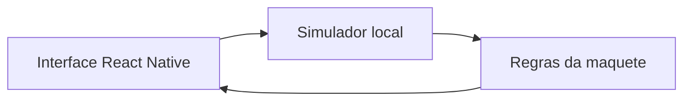

# Arquitetura do protótipo

## Objetivo e responsabilidade

Aplicativo geral para reunir todas as funções da maquete. Desenvolvimento do app: César. Primeira entrega: interface interativa, dados fictícios e cenários de comunicação.

## Organização

- App.tsx: navegação entre Painel, Configurações e Evidências; apresentação dos controles.
- src/domain/maquette.ts: tipos e regras de iluminação, indicador e leitura antiga.
- src/hooks/useSimulator.ts: leituras fictícias, atraso de confirmação, falhas e atividade da sessão.
- tests/maquette.test.ts: verificação das regras.

## Regras desta versão

- Temperatura 24,6 °C e umidade 58% são dados de exemplo fixos. O horário de recebimento é atualizado a cada segundo em operação normal.
- Comando normal confirma após 650 ms; durante a espera, novos comandos ficam pausados.
- Intensidade aceita inteiros de 0 a 100. Zero desliga; ligar restaura o último percentual positivo.
- O controle envia ao soltar o slider. O valor reportado só muda após a confirmação.
- Sem comunicação ou leitura com pelo menos 10 s de idade: controles desabilitados, última leitura preservada e aviso explícito.
- Falha de comando: após 5 s, informar não confirmado e manter estado reportado.
- Trocar cenário ou reiniciar cancela comandos pendentes. Eles não são reaplicados ao reconectar.
- Azul, verde, vermelho e desligado são opções de indicador, sem significado clínico atribuído.
- Reiniciar ou recarregar perde a sessão, pois não há persistência nesta versão.

Os intervalos são parâmetros escolhidos para demonstração e devem ser medidos/revisados na integração real.

## Próximas interfaces

Node-RED/ESP32 não estão implementados neste app. A próxima versão substituirá o simulador por um serviço com o mesmo comportamento esperado: consultar estado, enviar comando e esperar confirmação. O contrato HTTP/JSON do pré-projeto permanece uma proposta a discutir com Gabriel.

## Evidência

TIRE PRINT DESTA PARTE: árvore de arquivos no GitHub e diagrama desta página. Legenda: organização inicial do aplicativo e separação entre interface, simulador e regras.
