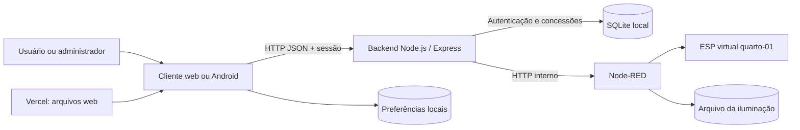
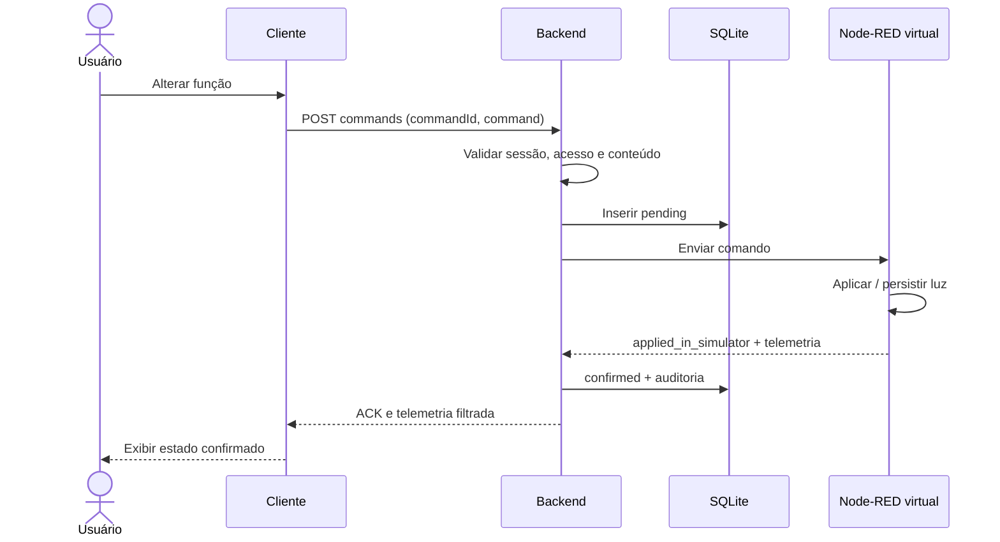

# Arquitetura de software

**Referência: SAMAHI 0.6.0.** Visões de contexto, estrutura, execução e implantação, inspiradas em arc42/C4. [Índice](README.md) · [decisões](adr/README.md).

Versões declaradas e função de cada biblioteca: [tecnologias e dependências](tecnologias.md).

## 1. Objetivo e partes interessadas

O aplicativo centraliza consulta de dados e controle das funções disponíveis na maquete. César desenvolve interface/backend; Gabriel integra hardware/firmware; Matheus usa documentação e evidências na monografia; equipe e orientador avaliam o resultado. A interface adapta a composição a telefone e navegador, compartilhando domínio e identidade visual.

Prioridades: autorização no servidor; estado apresentado somente após confirmação; configuração persistente; falha perceptível e preservação do último estado; rastreabilidade para desenvolvimento e relato acadêmico. Não foram definidos SLOs de disponibilidade ou metas quantitativas de latência.

## 2. Escopo e restrições

- Frontend Expo/React Native/TypeScript; backend Node.js/Express/Better Auth; SQLite local; Node-RED separado.
- Operação inicial no PC, transferível ao notebook. Rede local HTTP é o cenário atual de ensaio.
- Dispositivo implementado: virtual, um quarto. Não há transporte para ESP físico implementado nesta cadeia.
- Vercel publica o cliente estático. Não hospeda o SQLite local nem o Node-RED por consequência dessa publicação.
- Manchester é seleção manual independente. Gás por ADC não informa espécie/toxicidade/concentração calibrada.
- Não há coleta contínua de incidentes no backend sem requisições de telemetria, nem notificações push.

## 3. Contexto e contêineres

O diagrama representa processos lógicos. SQLite é arquivo aberto pelo backend, não um servidor de banco em outra porta. O ESP virtual é código executado pelo processo Node-RED. O browser/Android não acessa o banco ou os cenários diretamente pelo fluxo autenticado.

| Componente | Responsabilidade | Persistência/limite |
| --- | --- | --- |
| Cliente | Login, catálogo, painel, formulários, estado pendente e mensagens | Preferências locais; token em memória |
| Backend | Sessão, administração, concessões, validação, proxy de dispositivo e auditoria | SQLite + segredo local |
| Node-RED | Entradas HTTP, amostragem virtual e cenários de teste | Processo separado; endpoints locais sem autenticação própria |
| Simulador | Modelo do quarto, ACK, sensores virtuais e aplicação de horários | Luz em JSON; sensores/cenários/indicador em memória |
| Shared | Validação da agenda e cálculo do período | Sem estado; usa relógio recebido |

## 4. Organização interna

Entrada `index.ts` → `App.tsx` → `src/ui/ConnectedApp.tsx`. O login monta o workspace autenticado usado pelo painel em `DemoApp.tsx`; esse nome é legado e não significa acesso anônimo. Hooks orquestram I/O; domínio mantém regras; serviços encapsulam HTTP e preferências. Código legado de demonstração continua no repositório, mas não é fallback automático da entrada atual.

No backend, `core.mjs` cria banco, autenticação e serviços de acesso/auditoria; `server.mjs` define middleware e rotas; `setup.mjs` inicializa a primeira conta; `backup.mjs` exporta os dados. `createApp(options)` e `createCore(options)` aceitam configuração injetada para testes isolados. `shared/lighting-schedule.cjs` é consumido por cliente, backend e Node-RED.

## 5. Fluxos de execução

### Login

O cliente hidrata preferências antes de usar o endereço. Login com email/senha em `/api/auth/sign-in/email`; lê `set-auth-token`, consulta `/api/me` e `/api/rooms` e monta a área autenticada. No nativo usa Bearer com `credentials: omit`; no web usa Bearer e permite cookies. Não persiste senha/token em AsyncStorage. Reabrir/recarregar exige novo login na interface atual.

### Leitura

O hook consulta telemetria e histórico em ciclos de aproximadamente 2 s enquanto montado; não há WebSocket nem execução garantida em segundo plano. O backend verifica conta/quarto/grupos, consulta Node-RED com timeout de 5 s, verifica identidade/fonte e filtra campos por concessão. Cliente limita a requisição a 8 s. O histórico é consultado independentemente da permissão de telemetria.

`sampleAgeMs >= 10000` caracteriza leitura antiga no backend. Mudanças de estado online/offline/stale e mudanças de condição de gás são registradas em transação de observação. Falha de rede entre telefone e backend pode impedir qualquer novo registro no banco; ausência de evento não prova continuidade.

### Comando e confirmação

Na falha, o comando fica `unconfirmed`, a auditoria recebe `command_unconfirmed` e o cliente preserva o último estado reportado. Timeout não prova que o dispositivo deixou de aplicar algo. A chave `(actor, room_id, command_id)` permite reapresentar resposta já confirmada com corpo idêntico; corpo diferente ou estado não confirmado gera 409. Não é garantia de entrega exatamente uma vez entre processos nem sincronização global de usuários concorrentes. IDs gerados pelo app usam letras, números e hífens, compatíveis com ambos os serviços.

### Horários

O Node-RED aplica a programação nos ticks do simulador mesmo com o app fechado. Usa o relógio do computador convertido para `America/Sao_Paulo`. Não consulta um serviço de hora nem define a hora do ESP. Manual pausa a agenda, e reativar aplica o período atual. Arquivo inválido impede inicialização da instância persistente; falha de gravação impede confirmação da alteração. Detalhes em [Dia/Noite](modos-dia-noite.md).

## 6. Implantação

| Cenário | Cliente | Backend | Node-RED |
| --- | --- | --- | --- |
| PC local | Expo web 8081 | loopback 3001 | loopback 1880 |
| Telefone na LAN | Expo Go via Metro 8082 ou APK | IP privado do PC, 3002 no iniciador | permanece no PC em loopback |
| Web Vercel | HTTPS estático | serviço local separado, sujeito a conectividade e política do navegador | não publicado automaticamente |

O APK empacota a interface e pode executar sem Metro. Ele ainda precisa alcançar o backend, que precisa alcançar Node-RED. Firewall, isolamento Wi-Fi e mudança de IP são dependências da implantação, não erros resolvidos pelo build. [Roteiro operacional](operacao.md).

## 7. Conceitos transversais

- Segurança: sessão, concessões por quarto/grupo, CORS restrito, queries parametrizadas e rotas administrativas específicas. [Modelo de ameaças e limitações](seguranca.md).
- Dados: SQLite WAL e foreign keys; preferências locais versionadas; estado de luz externo ao banco. [Modelo](modelo-dados.md).
- Tempo: timestamps de auditoria ISO UTC; agenda em Brasília; idade de leitura fornecida pelo serviço, não medição do tráfego.
- Observabilidade: histórico funcional dos últimos 100 eventos por quarto; não equivale a plataforma de métricas/tracing ou log inviolável.
- Compatibilidade: `source: node-red-simulator` e `status: applied_in_simulator` são verificados explicitamente. Trocar apenas o endereço por um ESP real não conclui a integração.

## 8. Qualidade, riscos e evolução

Há testes de domínio/contrato e HTTP com SQLite temporário, CI e exportação estática. [Requisitos](requisitos.md) e [testes](testes-versoes.md) relacionam cenários e evidências. Não foram medidos desempenho, disponibilidade, consumo elétrico ou confiabilidade física.

Riscos conhecidos: HTTP na LAN; Node-RED sem autenticação de aplicação; processo/arquivo único sem alta disponibilidade; histórico dependente de consultas; sem retenção automática; último comando concorrente pode prevalecer; validação de telemetria do backend é parcial, não um parser completo de cada campo; relógio do host influencia horários; estado de indicador/gás não persiste no simulador.

Próximas evoluções precisam de decisão e teste próprios: transporte/ACK físico com Gabriel, identidade/autenticação de dispositivo, HTTPS e implantação de rede, monitoramento autônomo, migrações incrementais e política de retenção. Não fazem parte da garantia atual. [ADRs](adr/README.md) registram as escolhas já materializadas.
