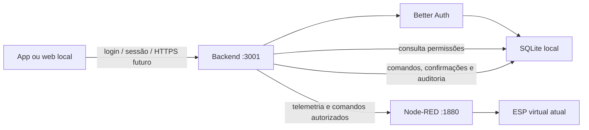

# Autenticação e persistência locais — SAMAHI

## Escopo entregue

Base local de autenticação, cadastro e autorização. Não é uma migração para nuvem. O APK v0.4.1 já distribuído não inclui esta mudança: esta etapa está na branch feat/auth-local e exige revisão e novo APK antes do teste Android.

Stack: Node.js >=24.15 (testado com 24.19), Express 5.1, Better Auth 1.7.10, SQLite por node:sqlite. Pacotes do servidor isolados em backend/package.json e backend/package-lock.json. Não entram no bundle Expo nem no envio EAS. Não há mensalidade de hospedagem para executar esta base local.

## Como iniciar neste PC

1. Na pasta backend, executar uma vez `npm.cmd ci --ignore-scripts` (já instalado neste PC). Instalar Node.js 24.15 ou superior no notebook.
2. Abrir Configurar-Administrador.cmd na raiz. Informar nome, email e senha de 12 a 128 caracteres diretamente no terminal. A senha fica oculta e não é enviada ao chat nem colocada em argumentos/comandos. O programa recusa sobrescrever uma instalação com usuários existentes.
3. Abrir Iniciar-Backend.cmd. Por padrão atende apenas http://127.0.0.1:3001.
4. Iniciar o Node-RED pela instalação existente na pasta TCC/samahi-node-red.
5. No projeto do app executar `npm.cmd run web -- --port 8081`. Abrir http://localhost:8081 e usar o login criado. Endereço do backend: http://127.0.0.1:3001.
6. O administrador inicial recebe concessões para operar quarto-01, dispositivo ESP32-quarto-01. Usuários e quartos novos não recebem permissões automaticamente.
7. Criar os usuários pela área administrativa, selecionar quarto e usuário e salvar os níveis de cada grupo.

É necessário manter backend e Node-RED funcionando para controlar a maquete. O login local não exige serviço de email ou internet depois de instalar dependências. Não foram criadas contas reais da equipe: somente contas descartáveis de teste em um banco separado em entregas/auth-browser.

## Contas e sessões

Better Auth cuida da senha e do formato de hash, criação/verificação/revogação de sessões e limitação de tentativas. Senhas não são guardadas em texto puro. Não foi escrito um algoritmo próprio de criptografia ou JWT. Cadastro público está desativado. Só o administrador cria contas comuns, desativa, reativa e redefine senhas. Desativação e redefinição apagam as sessões do usuário. Cada pessoa pode alterar sua própria senha informando a atual; a opção encerra outras sessões.

O token Bearer fica apenas na memória do app, nunca em localStorage ou no Git. O servidor mantém a sessão no SQLite por até 8 horas; o cliente pede novo login ao recarregar/encerrar o app. Login automático persistente em SecureStore é uma evolução futura. Cookies do Better Auth também podem existir no navegador, mas o cliente atual usa Bearer e não restaura automaticamente a sessão. Sair confirma o encerramento no servidor; falha de rede não é anunciada como encerramento bem-sucedido.

Não há recuperação automática por email. Para usuários comuns, o administrador redefine a senha. Recuperação offline do único administrador, múltiplos administradores e convite por email ainda precisam de fluxo específico; não apagar o banco para contornar esquecimento.

## Autorização efetiva

Toda rota de dados exige sessão. O papel admin permite administrar cadastros; não ignora concessões para operar ou ler sensores. Grants são consultados novamente a cada requisição.

| Grupo | Níveis | Efeito |
| --- | --- | --- |
| Iluminação | nenhum, leitura, controle | Ligar/desligar, 0–100% e automático exigem controle |
| Sensores | nenhum, leitura | Ler sensores e reconhecer gás exigem leitura; reconhecimento não muda detecção nem Manchester |
| Manchester | nenhum, leitura, controle | Selecionar cor exige controle |
| Histórico | nenhum, leitura | Consultar os últimos 100 eventos daquele quarto |

A API remove da telemetria os campos de grupos não autorizados. Quarto sem concessão não aparece para usuário comum. Novo cadastro não cria automaticamente um dispositivo no Node-RED: o simulador atual só atende quarto-01. O id do quarto e do ESP precisam coincidir com a telemetria recebida.

## Dados persistidos e modelo

| Tabela | Conteúdo |
| --- | --- |
| user, account | Identidade, email, papel, situação e credencial gerenciada pelo Better Auth |
| session, verification, rateLimit | Sessões, suporte da biblioteca e limitação de tentativas |
| rooms | ID, nome, leito, ala, dispositivo associado, ativo/inativo |
| grants | Usuário + quarto + grupo + nível, com referências e restrições SQL |
| commands | Autor, quarto, commandId, pedido, status e confirmação recebida |
| audit | Horário, autor, quarto, ação e detalhes sem senhas/tokens |
| latest_readings | Último snapshot obtido do Node-RED por quarto e horário de recebimento |

SQLite usa WAL, chaves estrangeiras e schemaVersion 1. IDs/leitos/dispositivos duplicados são rejeitados. Não há exclusão destrutiva de quartos/contas nesta interface: quarto pode ficar inativo e usuário desativado. Mudanças de gás são auditadas quando observadas pelas consultas ao backend; não é coleta contínua se todos fecharem o app. Não guardamos cada amostra a cada dois segundos nem dados de pacientes.

## Comandos e falhas

Cliente envia commandId e estado desejado. Servidor verifica sessão, quarto, nível e valores antes de encaminhar ao Node-RED. O pedido fica pending; só recebe confirmed quando a confirmação corresponde ao ID e declara applied_in_simulator. A interface não aplica o estado antes dessa resposta. Falha vira unconfirmed: pode ter havido execução sem resposta, por isso não há reenvio automático. Mesmo ID/pedido já confirmado devolve confirmação existente sem reenviar; ID reaproveitado com outro pedido ou incerto retorna 409.

Node-RED tem timeout de 5 s e o cliente 8 s. Erro não ativa demonstração interna como fallback. Estado virtual é diferente de persistência: reiniciar Node-RED reinicia seus atuadores simulados, mesmo que comandos antigos estejam registrados no SQLite. Histórico não deve ser usado como estado atual do equipamento.

## Rotas para estudar

- /api/auth/sign-in/email, sign-out, change-password: Better Auth.
- GET /api/me e GET /api/rooms: identidade e quartos autorizados.
- GET/POST /api/users, POST /api/users/:id/disable, enable e password: administração.
- PUT /api/users/:id/grants/:roomId: substitui os quatro níveis validados.
- POST /api/rooms e PUT /api/rooms/:roomId: cadastro/edição, ID permanece fixo.
- GET /api/rooms/:roomId/telemetry e history: campos filtrados e auditoria.
- POST /api/rooms/:roomId/commands: autorização e confirmação.

Administração nativa do plugin Better Auth não é exposta diretamente: as rotas administrativas passam pelas validações do SAMAHI. Queries SQL usam parâmetros; não inserir texto de formulários em SQL. O destino Node-RED vem da configuração do servidor, não de URL enviada pelo usuário.

## Configuração e acesso pelo telefone

Variáveis lidas pelo processo do backend (não carrega .env automaticamente): SAMAHI_HOST (127.0.0.1), SAMAHI_PORT (3001), SAMAHI_PUBLIC_URL (http://127.0.0.1:3001), SAMAHI_NODE_RED_URL (http://127.0.0.1:1880), SAMAHI_DATA_DIR (data) e SAMAHI_ORIGINS (lista separada por vírgulas). No app, EXPO_PUBLIC_BACKEND_URL é somente um endereço público; também há campo de endereço no login.

Para LAN será necessário escolher a interface/IP do notebook, configurar URL/origens, firewall e transporte protegido. O servidor permanece em loopback nesta entrega. HTTP local transmite senha/token sem TLS; esta configuração é de desenvolvimento no próprio PC. Não publicar na internet ou conectar dados reais de pacientes. Para uso na rede compartilhada e pelo Vercel, preparar HTTPS e proteger o acesso direto ao Node-RED. CORS não é autenticação.

## Backup e transferência ao notebook

1. Na pasta backend, executar `npm.cmd run backup`. Gera backend/backups/data-hora com samahi.sqlite e auth-secret. VACUUM INTO cria uma cópia consistente mesmo com WAL. Não copiar só o arquivo .sqlite de uma instalação ativa sem esse procedimento.
2. Guardar o backup em local privado: contém dados de contas/sessões e segredo de autenticação. Git e EAS o excluem.
3. No notebook, obter a mesma versão do código e instalar dependências do app e de backend com npm ci. Não copiar node_modules entre sistemas.
4. Com backend do notebook parado, restaurar os dois arquivos em backend/data. Se já existir instalação no notebook, preservar um backup dela antes; não sobrescrever contas existentes sem decisão explícita.
5. Ajustar os endereços, iniciar Node-RED/backend/site e fazer novo login. Testar permissões e executar o mesmo roteiro. Não foi feita transferência física a outro computador nesta entrega.

## Evidências e verificação

Em 15/10/2026: suíte integrada HTTP com banco temporário comprovou login válido/inválido, bloqueio de cadastro público, acesso negado, filtragem por grupo, controle negado para leitor, deduplicação de comandos, colisão de ID, unicidade de leito, persistência após reinício, histórico, redefinição de senha com revogação, desativação, logout e backup SQL consistente. Os 14 testes anteriores continuam separados. Testes não criam as contas reais.

Na interface web: conta temporária entrou, selecionou quarto-01, recebeu leituras do simulador isolado, enviou 25% e recebeu confirmação com evento persistente. O upstream de teste usa o mesmo módulo de simulação do Node-RED; não é um teste novo de ESP físico. Capturas em docs/evidencias/auth-local. Servidores temporários são encerrados depois da verificação.

TIRE PRINT DESTA PARTE: login, permissões por quarto, cadastro persistente e evento confirmado; não capturar senhas/tokens.

MOSTRE FUNCIONANDO EM VÍDEO OU GIF: criar conta, conceder só leitura, entrar como usuário e mostrar controle negado; administrador concede controle e comando passa; reiniciar backend e conferir quartos; revogar acesso e conferir bloqueio; backup/restauração no notebook.

Pendente: revisão da equipe, primeiro administrador real definido por César no terminal, testes Android/LAN/notebook, HTTPS, novo APK e hardware real. Não houve merge nem publicação desta etapa. Branch deriva da configuração de APK (PR #9), ainda não incorporada à main no início desta implementação.

## Referências primárias

- https://better-auth.com/docs/integrations/express — handler e sessão no Express.
- https://better-auth.com/docs/adapters/sqlite — driver node:sqlite.
- https://better-auth.com/docs/plugins/bearer — sessão Bearer para clientes de API.
- https://better-auth.com/docs/plugins/admin — gestão de contas e senhas.
- https://better-auth.com/docs/concepts/database — schema/migração programática.
- https://nodejs.org/api/sqlite.html — SQLite no Node.js.
- https://www.sqlite.org/lang_vacuum.html — cópia com VACUUM INTO.
