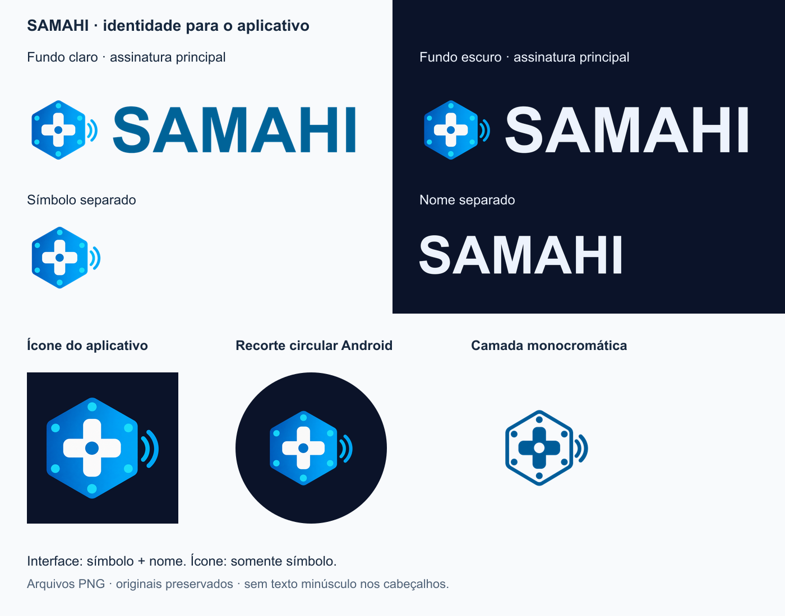

> **Situação atual:** recurso incluído no código 0.6.0 e no [APK registrado](../apk-v0.6.0.md). Ensaios abaixo são registros da etapa de implementação; aceite completo do APK instalado e integração física permanecem separados. Consulte o [índice atual](../README.md).

# Identidade visual — SAMAHI

Padrão para interface, ícone do aplicativo e materiais do projeto. O símbolo da marca existente foi isolado e refinado a partir de `assets/samahi-logo.png`, preservado como referência histórica. Nome: **SAMAHI — Sistema de Automação e Monitoramento de Ambientes Hospitalares Inteligentes**.



## Arquivos e uso

Todos os arquivos abaixo ficam em `assets/brand/`. PNGs são imagens raster; não são matrizes vetoriais.

| Arquivo                                                  | Dimensão    | Uso                                                                |
| -------------------------------------------------------- | ----------- | ------------------------------------------------------------------ |
| `symbol.png`                                             | 1024 × 1024 | Símbolo separado, transparente, materiais e composições            |
| `symbol-ui.png`                                          | 256 × 256   | Símbolo leve usado no componente do app                            |
| `wordmark-light.png` / `wordmark-dark.png`               | 938 × 182   | Somente o nome; light para fundo claro, dark para fundo escuro     |
| `logo-horizontal-light.png` / `logo-horizontal-dark.png` | 1250 × 300  | Símbolo + nome, com fundo transparente                             |
| `logo-complete-light.png` / `logo-complete-dark.png`     | 1250 × 420  | Assinatura com descrição por extenso para documentos/apresentações |
| `app-icon.png`                                           | 1024 × 1024 | Ícone quadrado opaco para Expo; fundo azul profundo                |
| `adaptive-foreground.png`                                | 1024 × 1024 | Primeiro plano transparente Android, marca central com até 560 px  |
| `adaptive-monochrome.png`                                | 1024 × 1024 | Máscara de transparência para ícone temático Android               |
| `symbol-monochrome.png`                                  | 1024 × 1024 | Versão de uma cor para materiais                                   |
| `favicon.png`                                            | 64 × 64     | Ícone da aba web, sem nome pequeno                                 |
| `source-symbol.png` / `source-monochrome.png`            | 1254 × 1254 | Fontes raster selecionadas, antes das exportações técnicas         |

## Regras de aplicação

- Interface: símbolo e nome juntos, sem a descrição por extenso em tamanho minúsculo. Cabeçalho mobile usa até 150 px; desktop, 180 px. Para usos novos, preferir ao menos 136 px na assinatura e 32 px no símbolo isolado. O favicon é a exceção técnica de tamanho reduzido.
- Ícone instalado: somente símbolo. O nome SAMAHI já aparece como rótulo do aplicativo no sistema operacional.
- Usar a assinatura light em superfícies claras e dark em superfícies escuras. Sem placa branca atrás da marca no modo escuro.
- Preservar proporção e transparência. Não esticar, recortar arcos/detalhes, inclinar ou adicionar sombras. Nas composições externas, deixar ao redor um espaço livre de pelo menos 1/4 da altura do símbolo, além da margem do arquivo.
- Cores de apoio: azul `#006398`, ciano, fundo profundo `#0B1329`, nome claro `#EDF3FD`. A arte colorida preserva variações de azul da referência; não representa um preenchimento vetorial de cor única.
- A cor da marca é fixa. Manchester continua exclusivamente associado à triagem do paciente; não recolorir a logo para representar gás ou prioridade.
- A versão completa é para áreas em que a descrição permanece legível. Em áreas pequenas, usar a assinatura horizontal ou apenas o símbolo.
- A camada monocromática foi desenhada como contorno e espaços transparentes. O Android usa sua transparência para aplicar a cor do tema; o azul do PNG não fixa a cor final no launcher.

## Integração e manutenção

`src/ui/Brand.tsx` compõe símbolo e nome em imagens separadas. O tema escolhe a cor do nome; tamanho proporcional e texto acessível ficam centralizados nesse componente. Login, menu desktop e cabeçalho mobile o reutilizam. Não depende de fontes instaladas no telefone.

`app.json` aponta para ícone, primeiro plano adaptativo, camada monocromática e favicon novos. O fundo adaptativo é `#0B1329`; não há imagem de fundo concorrente. Pacote Android, identificação EAS e versão permanecem os mesmos nesta revisão. Não há alteração de autenticação, sensores, permissões ou comandos.

**O APK anterior não muda com essa alteração de código.** Para conferir o ícone na tela inicial, gerar e instalar uma nova build. Expo Go permite conferir a marca dentro da interface, mas seu próprio ícone não se torna o SAMAHI. Nenhuma build nativa ou splash personalizado foi gerado/configurado nesta etapa. Ícones temáticos dependem do launcher/Android e da preferência do aparelho.

As exportações já estão no Git e o app não precisa de Sharp. Para reproduzir os PNGs a partir das fontes, instalar Sharp como ferramenta local separada e executar, em PowerShell:

```powershell
$env:SAMAHI_SHARP_PATH = 'CAMINHO/DO/PACOTE/sharp'
node scripts/brand-assets.mjs
```

Se Sharp estiver resolvível pelo Node, a variável é opcional. O script apenas dimensiona, compõe imagens e rasteriza o nome em Arial Bold por SVG intermediário; não usa IA nem rede ao executar. A fonte disponível no ambiente de exportação pode afetar a renderização ao regenerar; os PNGs versionados são a referência visual. Não foram copiados arquivos de fontes comerciais para o repositório.

## Origem das artes e prompts

Modo: ferramenta integrada `image_gen`, edição com referência e transparência. Não foi usado CLI/API externo. A arte original do repositório foi a referência; as fontes selecionadas foram copiadas para o projeto. Tentativas monocromáticas com ruído foram descartadas. Esta documentação não declara registro de marca ou exclusividade comercial.

Prompt final do símbolo colorido:

> Use case: logo-brand / background-extraction. Input image is the existing SAMAHI logo, edit target and identity reference. Produce ONLY the isolated emblem at the left, separated from all lettering, as a production high-resolution app brand symbol on a genuinely transparent background. Preserve its identity: upright blue rounded hexagon, centered white medical plus/cross with round ends, subtle bright cyan connection nodes and the small wireless arcs integrated at the right edge. Refine the low-resolution edges into crisp clean flat vector-like geometry, balanced and legible at small sizes. Keep the blue/cyan/white palette and original motif, not a new logo concept. Square canvas, emblem precisely centered, generous even transparent padding on every side, no crop. No words, no SAMAHI lettering, no subtitle, no surrounding white card, no square backplate, no drop shadow, no 3D, no mockup, no variations grid. Deliver a single large clean isolated symbol suitable to derive icon sizes.

Prompt final da versão monocromática:

> Create the clean single-color BLUE stamp variant of the supplied brand emblem. The sole opaque color is saturated cobalt blue #006398; do not use white anywhere. Rounded hexagon BLUE OUTLINE, solid BLUE rounded medical plus with a truly transparent central round hole, six small solid BLUE round network dots, two smooth BLUE wireless arcs to the right. The inside of the hexagon between these blue shapes is totally empty transparent background. Completely flat: no fills between shapes, no gradient, no lighting, no shading, no texture, no grain, no noise, no distress, no speckles. Every geometric blue stroke is smooth and opaque. SAME main silhouette/proportions as reference. One centered mark on square canvas with generous transparent margins. No text, no background, no mockup.

## Evidências e validação

**TIRE PRINT DESTA PARTE:** assinatura no login e no cabeçalho do quarto em tema claro/escuro; prancha com símbolo/nome separados; ícone do APK 0.6.0 na tela inicial após instalação, registrando versão e aparelho.

**MOSTRE FUNCIONANDO EM VÍDEO OU GIF:** alternar tema no app; fechar e abrir o aplicativo pelo novo ícone após instalação. Não apresentar a prancha de recorte circular como captura de aparelho: ela é uma conferência gráfica da camada exportada.

Verificações automáticas: lint, TypeScript, 18 testes e exportação web. O teste de persistência precisou de execução com acesso à pasta temporária, bloqueada pelo sandbox na primeira tentativa. Conferência de dimensões/transparência das imagens e revisão visual da prancha. Ícone base e favicon têm alpha inteiramente opaco; camadas adaptativas possuem fundo transparente. A marca foi reduzida a 560 px nas camadas adaptativas para manter também os arcos dentro da área circular segura.

Navegador: login desktop 1280 × 720 e painel autenticado mobile 390 × 844 nos temas claro/escuro, com backend/serviço virtual e banco descartáveis. Capturas `login-desktop-light.png`, `login-desktop-dark.png`, `painel-mobile-light.png` e `painel-mobile-dark.png` nesta pasta. Sem erro de console no ensaio; aviso existente de animação nativa indisponível na web, que usa JavaScript. Não houve mudança de fluxo ou ensaio físico de hardware. O ícone foi incluído na build 0.6.0; sua validação no Android instalado permanece pendente.

## Referências técnicas

- [Expo — Splash screen and app icon](https://docs.expo.dev/develop/user-interface/splash-screen-and-app-icon/): ícone PNG quadrado 1024 px, opaco, sem cantos arredondados embutidos; configuração por plataforma.
- [Android Developers — Adaptive icons](https://developer.android.com/develop/ui/compose/system/icon_design_adaptive): separação das camadas, máscara aplicada pelo sistema, camada monocromática e área segura central. Os arquivos adaptativos mantêm a marca centralizada com margem extra.

Fontes oficiais consultadas para preparação; essas referências especificam os formatos, não comprovam teste de build ou instalação.
