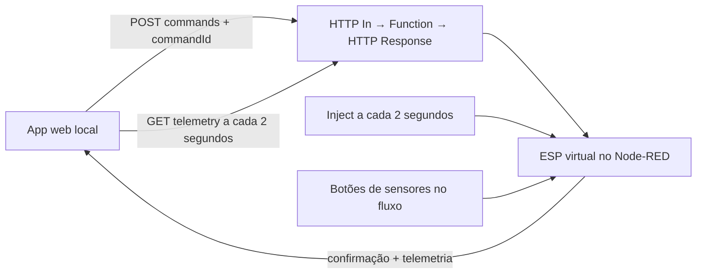

> **Registro histórico.** Instruções e resultados da etapa original; não é o guia operacional atual. Consulte [integracao-node-red-local.md](integracao-node-red-local.md) e o [índice atual](README.md).

# Integração local do SAMAHI com Node-RED

## Entrega e arquitetura

O app web local envia comandos HTTP e consulta a telemetria a cada 2 segundos. O Node-RED mantém um ESP virtual em memória, atualiza suas leituras a cada 2 segundos e devolve confirmação identificada como `applied_in_simulator`. Nenhum equipamento físico foi conectado. O app só altera o estado reportado após resposta válida; não usa aplicação otimista de comandos.



## Como usar neste PC

1. Node-RED: `C:\Users\cesar\Documents\TCC\samahi-node-red\Iniciar-Node-RED.cmd`.
2. App conectado: `C:\Users\cesar\Documents\TCC\tcc-maquete-app\Iniciar-App-Node-RED.cmd`.
3. Editor: http://127.0.0.1:1880/ — aba **SAMAHI — ESP virtual e API**.
4. App: http://localhost:8082/ — entre com César, acesse o quarto e use os controles de luz.
5. No Node-RED, clique no pequeno botão do lado esquerdo de cada Inject de teste para mudar temperatura/umidade, gás e luminosidade. Eles mudam entradas simuladas, não comandos da luz.
6. No app, o botão **Usar luz automática pelo LDR** devolve o controle ao simulador. Escuro usa a última intensidade positiva; claro apaga.
7. Para parar, Ctrl+C no terminal correspondente. Não iniciar duas instâncias na mesma porta. Reiniciar Node-RED reinicia o estado virtual.

O atalho do app define `EXPO_PUBLIC_NODE_RED_URL=http://127.0.0.1:1880` apenas para aquele processo. A URL do quarto pode ser editada em Conexões/Cadastro. O teste de conexão faz GET real quando a URL não é `https://servico.exemplo`. Sem variável, a demonstração interna anterior continua disponível; não existe troca silenciosa para dados internos se a API falhar.

## Reproduzir em outro checkout

Instale Node-RED 5.0.8 em uma pasta de runtime separada, como nesta instalação. Inicie seu executável com `--userDir <pasta-dados> --settings <caminho-absoluto-do-repo>/integration/node-red/settings.example.cjs`. Importe `integration/node-red/flows.json` pelo menu Importar do editor e clique em Deploy. O arquivo de configuração precisa carregar o módulo `simulator.cjs`; importar apenas o JSON não é suficiente. `node integration/node-red/build-flow.cjs` regenera o JSON exportável.

Nesta instalação, settings.js do runtime carrega o módulo do checkout atual. Não remover ou mover essa pasta sem ajustar esse caminho. O backup dos fluxos anteriores está no runtime em `data/flows-before-samahi.json`.

## Contrato HTTP v1 de bancada

Base: `/api/v1/rooms/quarto-01`.

| Método e rota | Responsabilidade |
| --- | --- |
| GET `/telemetry` | Última amostra, idade, sensores e atuadores |
| POST `/commands` | Validar comando, aplicar no ESP virtual e confirmar |
| POST `/simulation` | Configurar entradas e cenários de teste |
| POST `/reset` | Reiniciar estado virtual |

Exemplo de comando:

```json
{"commandId":"app-teste-1","command":{"kind":"light","on":true,"intensity":25}}
```

Comandos adicionais: `indicator` com `color` (red, orange, yellow, green, blue, off); `automatic`; `acknowledgeGas`. Desligar usa intensidade zero; religar envia a última intensidade positiva reportada. O cliente valida `commandId`, status e telemetria da resposta. Não há reenvio automático; os comandos definem estados, sem alternância implícita no servidor.

Exemplo de entrada de sensor:

```json
{"temperatureC":30,"humidityPercent":70,"gasRawAdc":3628,"ldrRawAdc":4063}
```

Rejeições: 400 corpo/comando inválido; 404 ambiente não cadastrado; 409 amostra antiga; 503 offline; 504 cenário de ausência de confirmação. Este último devolve erro imediatamente, não simula 5 segundos de espera. O cliente limita requisições a 5 segundos para indisponibilidade real da API.

`sequence`, `uptimeMs`, temperaturas, umidade, ADC de gás/LDR, limiares, modo/intensidade e buzzer seguem as ideias da bancada Wokwi. Diferenças explícitas: `source=node-red-simulator`, `sampledAt`, `sampleAgeMs`, identificação do comando, reconhecimento de gás e Manchester virtual. A sequência reinicia com o runtime/reset. O app calcula a idade usando `sampleAgeMs`, sem exigir relógios sincronizados. Estado e histórico não são banco de dados.

## Limites importantes

- Só `quarto-01` é cadastrado no servidor. Outros ambientes no app precisam ser implementados no backend; receberão 404.
- Manchester funciona aqui somente como atuador virtual, independente de gás. O código Wokwi entregue ainda não tem RGB nem esse comando.
- Indisponibilidade do sensor de gás é um cenário de teste; o firmware ADC original não identifica cabo desconectado.
- Firmware Wokwi atual ainda é serial. Para trocar o simulador pelo ESP será necessário transporte de rede, mapeamento das mensagens, confirmações e tratamento de falhas. Não basta apontar o app para o Wokwi.
- Sem autenticação de backend: perfis e permissões são demonstrativos na interface. Instância restrita ao próprio PC; não abrir o editor/API na rede ou internet como se já tivessem autorização por usuário.
- Celular não alcança o PC por `127.0.0.1`. Teste móvel em rede e APK conectado ficam pendentes. Vercel não foi atualizado nesta etapa.
- Temperatura/umidade usadas neste simulador são válidas. A adaptação física deverá incorporar falha DHT/null e validação antes de usar o contrato real.

## Código para estudar

- `src/services/nodeRed.ts`: HTTP, timeout e validação das mensagens.
- `src/hooks/useNodeRed.ts`: consultas periódicas, comandos pendentes, preservação do último estado e cancelamento de atualização da tela ao trocar ambiente/perfil. Cancelar na interface não desfaz comando que já chegou ao servidor.
- `src/hooks/useSimulator.ts`: seleção entre demonstração interna e API.
- `integration/node-red/simulator.cjs`: regras do ESP virtual e validação das entradas.
- `integration/node-red/build-flow.cjs` e `flows.json`: composição e nós do fluxo.
- `integration/node-red/settings.example.cjs`: configuração local reproduzível.

## Evidências e verificação

TIRE PRINT DESTA PARTE: fluxo com nós HTTP, atualização a cada 2 segundos e botões de entrada dos sensores; app com retorno de confirmação do Node-RED e luz em 25%.

MOSTRE FUNCIONANDO EM VÍDEO OU GIF: app pede 25%, apaga e religa; Node-RED altera temperatura/umidade e app atualiza; gás dispara a faixa, reconhecimento não altera Manchester; modo automático reage a escuro/claro; offline/timeout preservam estado reportado.

Resultados verificados em 10/10/2026: app web exibiu 24 °C/40%, controle de 25% foi confirmado e observado na API; alteração externa para 30 °C/70%/gás detectado apareceu no app; reconhecimento retornou à API sem retirar a detecção; modo automático enviado pelo app. Prints e transcrição da API ficam em `docs/evidencias/node-red/`. Verificação nativa/móvel não realizada.

Tipos, lint e 14 testes passaram. Exportação web concluída. O teste integrado `node integration/node-red/check-api.cjs` passou em periodicidade, confirmação, validação, offline, timeout, leitura antiga, reconhecimento de gás e CORS local. Botão Inject de temperatura/umidade testado no editor; campos padrão dos Inject corrigidos para eliminar avisos de configuração. O PR desta etapa tem base `feat/stitch-samahi` para isolar a integração do redesign ainda pendente; antes de incorporar à main, revisar a dependência e ajustar a base do PR. CI ampliado para validar também PRs com base em branches feat/.

## Referências oficiais consultadas

- [Node-RED — endpoint HTTP](https://cookbook.nodered.org/http/create-an-http-endpoint)
- [Node-RED — configuração, Function global context e CORS](https://nodered.org/docs/user-guide/runtime/configuration)
- [Expo — variáveis públicas do ambiente](https://docs.expo.dev/guides/environment-variables/)
- [Wokwi — LDR](https://docs.wokwi.com/parts/wokwi-photoresistor-sensor)
- [Espressif — ADC](https://docs.espressif.com/projects/arduino-esp32/en/latest/api/adc.html)
