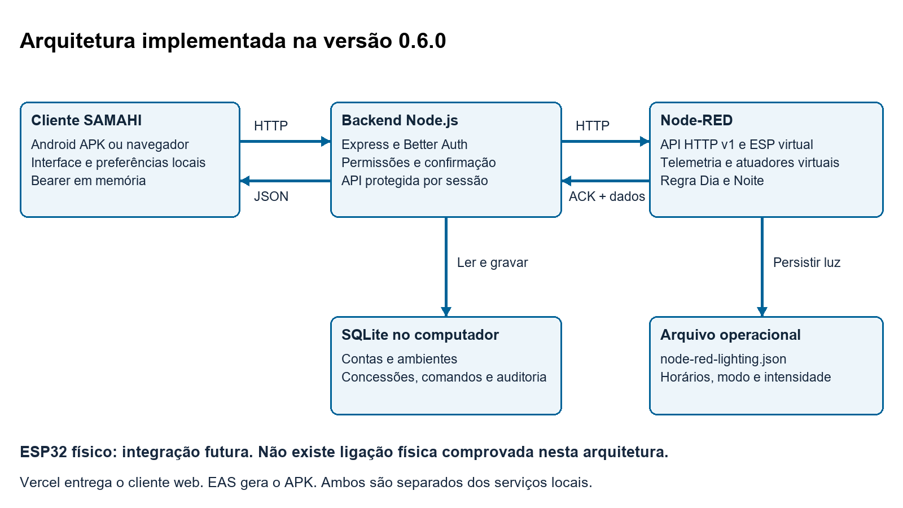
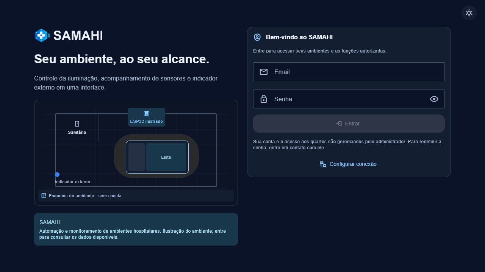
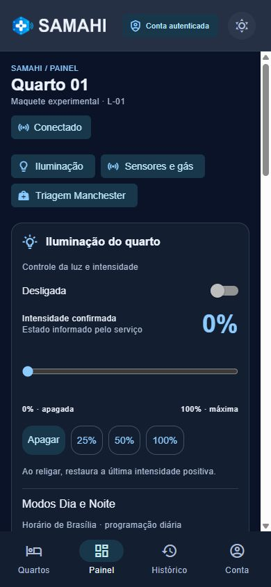
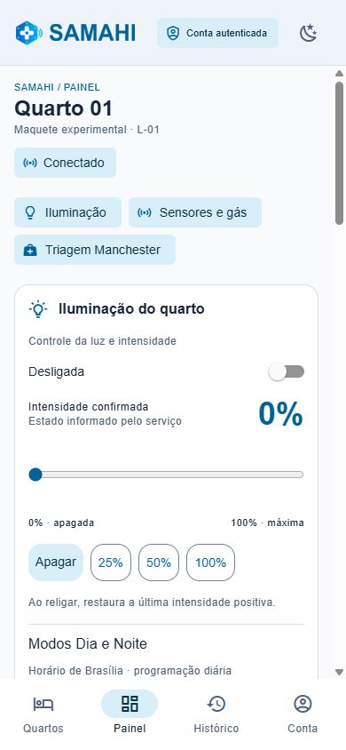
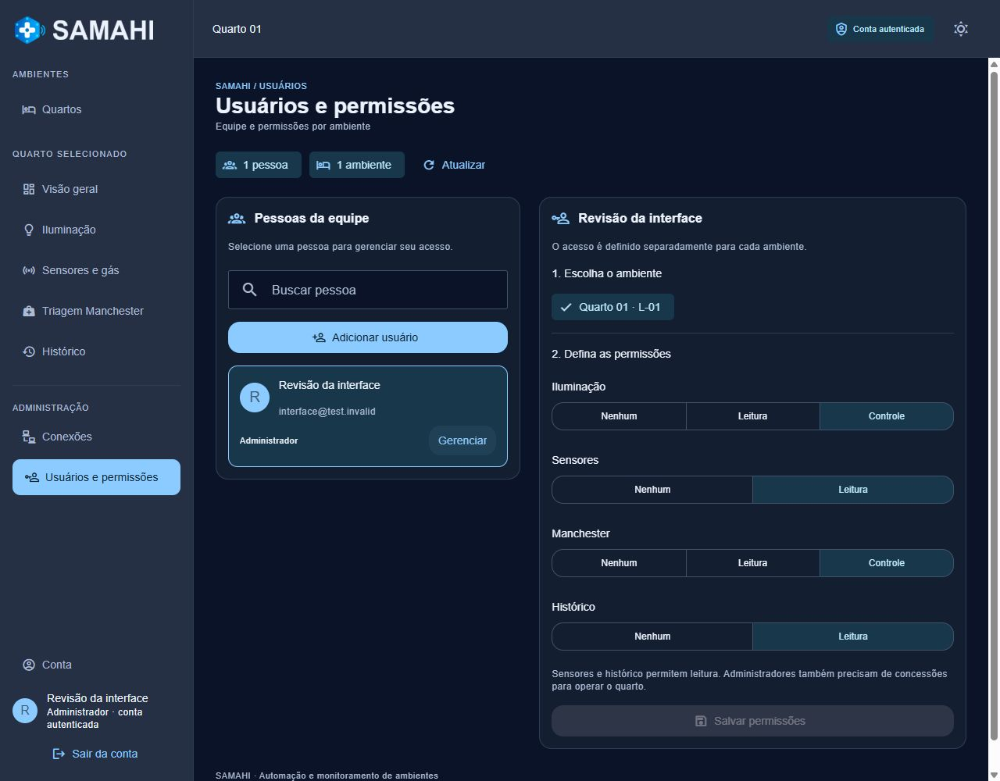
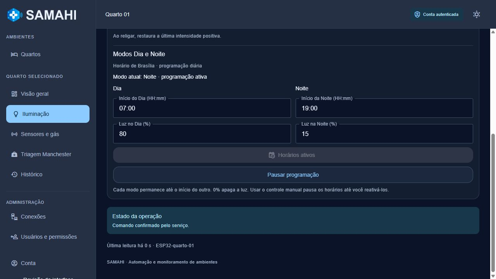
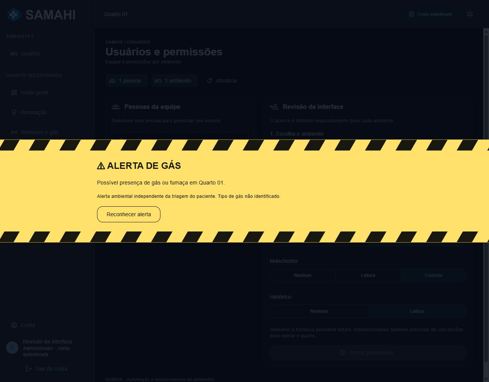
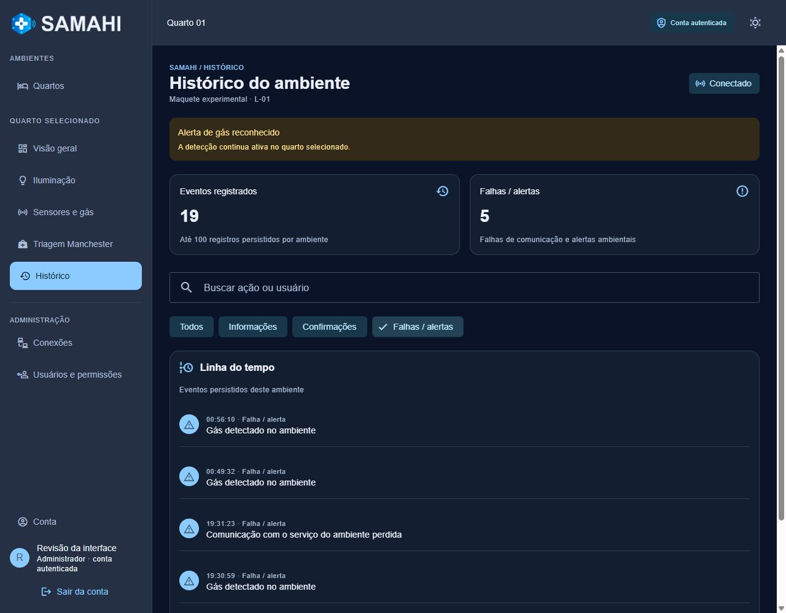
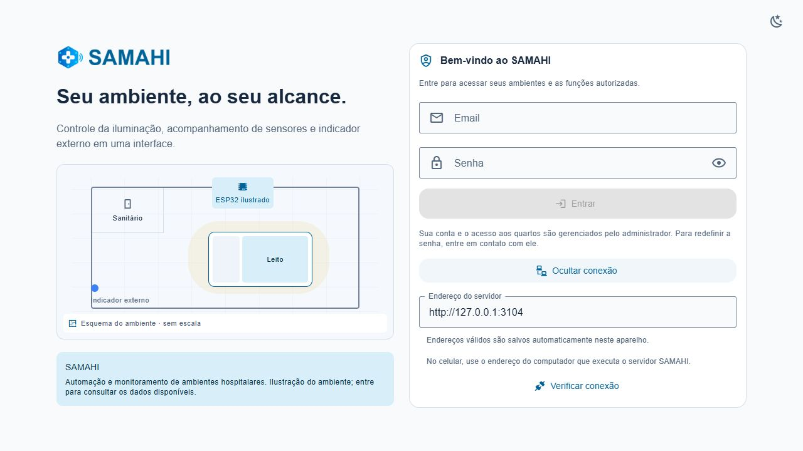

# Documentação do SAMAHI para atualização da monografia

Estágio do aplicativo e da integração virtual até a versão 0.6.0

Destinatário: Matheus, responsável pela monografia. Frente de software: César. Hardware e firmware: Gabriel. Registro consolidado em 17 de outubro de 2026, horário de Brasília.

### Como usar este material

Este documento reúne o funcionamento implementado, a arquitetura, as decisões técnicas e as evidências disponíveis para atualizar a monografia. A prioridade do TCC continua sendo o trabalho acadêmico e a apresentação; a maquete exemplifica as soluções estudadas.

O aplicativo Android 0.6.0 já foi compilado. Há login real, banco local no servidor, autorização por ambiente e integração com um ESP virtual no Node-RED. Isso comprova uma implementação de software e ensaios controlados; não comprova integração com ESP32 físico nem validação hospitalar. O aceite completo do APK no telefone ainda não foi registrado.

### Base documental

Código enviado ao EAS: 94f0ea1. Registro da build: 34b55fe. A base main 0f3d519 incorporou as mudanças até o PR 17. As capturas novas deste pacote foram feitas em ambiente isolado, com contas de ensaio e banco descartável; outras figuras são registros anteriores identificados na legenda.

### Roteiro de leitura

Seções 1 a 4: escopo, arquitetura e tecnologias.

Seções 5 a 12: regras, dados, comunicação e operação.

Seções 13 e 14: verificações e APK gerado.

Galeria: figuras com legendas, fonte e limite de interpretação.

Etapas finais: evidências pendentes, orientação de redação e referências funcionais.

O Word permite adaptar a redação. O ZIP inclui as imagens originais e o texto em Markdown. Os links do GitHub privado exigem acesso ao repositório; o pacote local permite consultar o conteúdo e as figuras sem esse acesso.


## 1 Escopo atual e responsabilidades

O SAMAHI centraliza funções de automação e monitoramento disponíveis para a maquete de um quarto. A interface permite acessar ambientes autorizados, controlar iluminação, acompanhar sensores, definir um indicador externo e consultar registros operacionais. O nome significa Sistema de Automação e Monitoramento de Ambientes Hospitalares Inteligentes.

| Frente | Responsável principal | Participação |
| --- | --- | --- |
| Aplicativo e backend | César | Interface, integração, autenticação, banco e distribuição. |
| Hardware e firmware | Gabriel | Circuito, ESP32 e adaptação do contrato ao equipamento. |
| Monografia | Matheus | Revisão teórica, método, resultados, figuras e referências. |

A divisão indica liderança de cada frente; os três integrantes se apoiam. Não há comprovação neste pacote de montagem física concluída, calibração dos sensores ou testes em ambiente hospitalar.

### Fronteiras do escopo

A operação começa por autenticação. O catálogo respeita as permissões da conta.

A planta do quarto é uma ilustração da interface, sem escala e sem comprovação de circuito montado.

O serviço atual atende apenas quarto-01 e ESP32-quarto-01. Cadastro no banco não cria outro dispositivo.

Fechadura, borda pulsante pela cor Manchester, notificações push, identificação de gases e integração física são expansões ou tarefas pendentes, não resultados desta versão.

Não há cadastro de pacientes, prontuário ou classificação clínica automatizada.

### Evolução desde o protótipo inicial

A solução começou com estados simulados dentro do cliente. Evoluiu para serviço Node-RED externo e, depois, backend autenticado com banco e auditoria. A interface deixou de oferecer acesso à demonstração. A regra de iluminação automática por LDR foi substituída por programação de horários. Na 0.6.0, a marca e as preferências locais também foram consolidadas. [S1 a S6]


## 2 Requisitos implementados e alcance

| Requisito | Comportamento atual | Verificação disponível |
| --- | --- | --- |
| Acesso por conta | Email/senha; administração cria contas e concede acesso. | API e navegador; login/quarto no Expo Go relatados por César. |
| Quartos | Cadastro, edição, ativação e associação a um dispositivo. | Persistência e permissões em banco de ensaio. |
| Luz manual | Ligar, apagar, 0 a 100% e restaurar intensidade ao religar. | Testes e confirmação pelo serviço virtual. |
| Dia e Noite | Dois horários e duas intensidades, no fuso de Brasília. | Relógio injetado, persistência e navegador. |
| Sensores | Temperatura, umidade e estado de gás. | Telemetria virtual e cenários controlados. |
| Manchester | Cor selecionada manualmente; não depende dos sensores. | Contrato e interface; LED físico pendente. |
| Alertas e histórico | Gás, leitura antiga, perda e retorno de comunicação. | API, testes e capturas; coleta depende de consultas. |
| Preferências | Conexão, tema e redução de animações ao reabrir. | 24 testes totais e reabertura real do navegador. |
| Distribuição | Web exportável e APK Android 0.6.0 instalável. | EAS FINISHED e arquivo inspecionado; aceite físico pendente. |

Implementado indica presença no código. Verificado indica um ensaio documentado e limitado ao cenário descrito. Pendente não deve ser convertido em resultado esperado apresentado como se já tivesse sido obtido.

Não foi realizado ensaio de desempenho com usuários, comparação estatística, medição de economia de energia ou avaliação de segurança clínica. O intervalo de consulta de dois segundos é uma configuração, não uma garantia de tempo real. [S1 a S6]


## 3 Arquitetura de execução

Figura 1 Arquitetura implementada do SAMAHI

Fonte: Elaboração deste pacote a partir do código 0.6.0.

O que esta imagem permite observar: Separação entre cliente, backend, banco, serviço virtual e arquivo operacional.



O cliente Android ou web fala com a API do backend. O backend verifica a sessão e as concessões antes de encaminhar consultas ou comandos ao Node-RED. O resultado é validado e, quando aplicável, registrado no SQLite. O telefone não precisa acessar o editor Node-RED. [S1, S2]

O Node-RED mantém o dispositivo virtual e executa a regra diária de iluminação. O arquivo operacional da luz é independente do SQLite, permitindo que a programação continue enquanto o serviço está ativo, mesmo sem app ou backend abertos. Isso não garante funcionamento com o computador suspenso.

Vercel distribui os arquivos do cliente web; não hospeda automaticamente o backend local, o banco ou o Node-RED. EAS compila o APK. GitHub, Notion e Trello apoiam o desenvolvimento e não são dependências de operação da maquete. [1, 8, 10]


## 4 Tecnologias e organização do código

| Tecnologia | Versão declarada | Papel |
| --- | --- | --- |
| Expo | ~57.0.26 | Desenvolvimento, exportação e empacotamento. |
| React e React Native | 19.2.3 e 0.86.3 | Componentes e execução móvel. |
| React Native Web | ^0.21.2 | Reutilização das primitivas no navegador. |
| React Native Paper | ^5.15.3 | Campos, cartões, temas e navegação. |
| TypeScript | ~6.0.3 | Tipagem e checagem estática. |
| AsyncStorage | 2.2.0 | Preferências não secretas no cliente. |
| Express e Better Auth | 5.1.0 e 1.7.10 | API, autenticação e gestão de sessões. |
| Node.js e SQLite | Node >=24.15.0 | Servidor com node:sqlite e banco em arquivo. |
| Node-RED | Runtime da bancada | Fluxo HTTP e simulação externa. |

As versões são as declaradas nos manifests do projeto. Os arquivos lock fixam a resolução utilizada na instalação; a documentação de terceiros pode tratar versões posteriores. [S7]

### Mapa para manutenção

src/ui/ConnectedApp.tsx: entrada, sessão, endereço e preferências.

src/ui/DemoApp.tsx: layout e navegação autenticada; o nome do arquivo é legado e não significa acesso à demonstração.

AccountManagement.tsx: contas, concessões e ambientes.

useAuthenticatedDevice.ts: consultas, comandos e adaptação da telemetria.

backend/server.mjs e core.mjs: rotas, autorização, biblioteca de autenticação e modelo persistente.

integration/node-red/simulator.cjs e shared/lighting-schedule.cjs: serviço virtual e regra compartilhada de horários.


## 5 Autenticação e permissões

A autenticação é real no backend, mesmo com equipamentos virtuais. Better Auth gerencia credenciais, sessões e limitação de tentativas. Cadastro público está desabilitado; o administrador cria contas comuns, redefine senhas e pode desativar ou reativar usuários. Cada usuário pode mudar a própria senha informando a atual. [2, S1]

O app usa sessão Bearer. O token do cliente fica em memória e não é incluído nas preferências locais. O servidor conserva a sessão no SQLite por até oito horas, mas o cliente atual não restaura automaticamente o login após encerrar ou recarregar. Redefinição/desativação revogam sessões conforme as rotas implementadas.

| Grupo | Níveis admitidos | Operação protegida |
| --- | --- | --- |
| Iluminação | Nenhum, leitura, controle | Luz manual e programação exigem controle. |
| Sensores | Nenhum, leitura | Leitura e reconhecimento de gás exigem acesso. |
| Manchester | Nenhum, leitura, controle | Mudança de cor exige controle. |
| Histórico | Nenhum, leitura | Consulta dos registros do ambiente. |

A concessão é específica para pessoa, ambiente e grupo de função. O papel de administrador permite gerir cadastros, mas não dispensa concessões para operar um quarto. O backend reconsulta permissões e filtra campos da telemetria; esconder botões sozinho não seria autorização suficiente.

### Limites atuais

Não há recuperação automática por email, convite por email ou login automático persistente. A senha não é guardada em texto puro pelo sistema de autenticação. Não registrar este desenho como auditoria externa de segurança ou como comprovação de conformidade legal. O tráfego HTTP local do ensaio não é cifrado.


## 6 Dados persistidos e origem da informação

| Armazenamento | Conteúdo | Observação |
| --- | --- | --- |
| SQLite do backend | Contas, sessões, ambientes e concessões. | Fonte de verdade de acesso e cadastro. |
| Tabela commands | Identificador, autor, pedido, status e retorno. | Deduplicação por autor, ambiente e commandId. |
| Tabela audit | Horário, autor, ação e detalhes do evento. | Não contém senha/token nos registros próprios. |
| latest_readings | Último snapshot válido por ambiente. | Não é série histórica de todas as amostras. |
| room_connection_state | Último estado online, offline ou stale. | Preserva deduplicação das transições. |
| Arquivo da iluminação | Modo, horários, intensidade e última intensidade positiva. | backend/data/node-red-lighting.json. |
| AsyncStorage do cliente | Endereço, tema e reduzir animações. | Não sincroniza entre aparelhos. |

O banco fica normalmente em backend/data/samahi.sqlite, acompanhado do segredo auth-secret. SQLite usa WAL, chaves estrangeiras e consultas parametrizadas. Duplicidade de leito/dispositivo é rejeitada. Contas e ambientes são desativados pela interface, sem exclusão destrutiva. [3, S1]

As tabelas próprias incluem rooms, grants, audit, commands, latest_readings e room_connection_state. Identidade, credencial e sessão também usam tabelas gerenciadas pela biblioteca de autenticação. Uma concessão relaciona usuário a quarto; o quarto associa um identificador de dispositivo. O histórico observado não deve ser confundido com o estado presente do equipamento.

Não são armazenados dados de pacientes nem cada leitura de dois segundos. O objetivo do histórico atual é registrar eventos e confirmações operacionais. Um futuro banco de séries temporais ou retenção integral precisaria de novo requisito e projeto.


## 7 Comunicação e confirmação de comandos

A integração atual é HTTP com corpos JSON. Não há MQTT implementado neste fluxo. O cliente consulta o backend; este consulta a API v1 do Node-RED. Os IDs de ambiente e dispositivo recebidos precisam corresponder ao cadastro. [4, S2]

| Rota do backend | Uso |
| --- | --- |
| GET /health | Verificar servidor SAMAHI, sem comprovar estado do ESP. |
| POST /api/auth/sign-in/email | Autenticação. |
| GET /api/me e /api/rooms | Conta e ambientes autorizados. |
| GET /api/rooms/:id/telemetry | Leitura filtrada por concessões. |
| POST /api/rooms/:id/commands | Comando autorizado e validado. |
| GET /api/rooms/:id/history | Últimos 100 registros do ambiente. |
| Rotas /api/users e /api/rooms | Administração de contas, concessões e cadastro. |

Exemplo ilustrativo de pedido de luz, com identificador único:

```json
{"commandId":"exemplo-luz-001",
 "command":{"kind":"light","on":true,"intensity":25}}
```

O backend registra pending, encaminha o pedido e valida a resposta. A confirmação atual exige o mesmo commandId e status applied_in_simulator. Só então registra confirmed e devolve telemetria ao cliente. O termo técnico permanece no contrato para indicar origem virtual, mesmo sem rótulos de demonstração na tela.

Pedido sem confirmação fica unconfirmed. Timeout não prova que o comando nunca foi executado; por isso não há reenvio automático. Um ID já confirmado com o mesmo pedido pode retornar a confirmação salva. ID reaproveitado com conteúdo diferente ou estado incerto é rejeitado. Para programação, a resposta deve também corresponder ao modo e aos horários/intensidades enviados. [S1, S2, S3]


## 8 Iluminação manual e modos Dia e Noite

A luz permite ligar, apagar e ajustar intensidade inteira de 0 a 100%. Zero representa apagado. Religar restaura a última intensidade positiva reportada. Percentual é o comando relativo do sistema, não medida de iluminância em lux nem luminância calibrada.

| Regra | Comportamento |
| --- | --- |
| Período Dia | Começa no horário configurado e termina quando começa Noite. |
| Período Noite | Continua até o próximo Dia, inclusive cruzando meia-noite. |
| Valores iniciais | Dia 07:00 e 100%; Noite 19:00 e 20%, editáveis. |
| Ativação | Primeira execução permanece manual até ativação explícita. |
| Controle manual | Pausa os horários até reativar; não é cancelado por uma virada. |
| Pausar e retomar | Pausa mantém intensidade; retomada aplica período atual. |

Horários HH:mm precisam ser diferentes; intensidades aceitam 0 a 100. O Node-RED calcula o período por Date.now e Intl.DateTimeFormat com America/Sao_Paulo. O fuso do telefone não determina a programação. O relógio do computador precisa estar correto; não existe consulta externa de hora a cada execução. [5, S3]

A regra roda nos ticks do serviço, aproximadamente a cada dois segundos, sem exigir o app aberto. Precisa do computador e do Node-RED ativos. Ao reiniciar, recupera configuração e aplica o período atual; não reproduz todas as viradas intermediárias. O LDR permanece como leitura técnica, sem determinar a luz.

```json
{"kind":"lightingSchedule","enabled":true,
 "schedule":{"timeZone":"America/Sao_Paulo",
 "dayStart":"07:00","nightStart":"19:00",
 "dayIntensity":100,"nightIntensity":20}}
```

A programação e o modo ficam em arquivo operacional persistente. Falha de gravação ou ACK incompatível não deve aparecer como configuração aplicada. Isso foi verificado em testes isolados. [S3]


## 9 Sensores gás e indicador Manchester

A telemetria inclui temperatura, umidade e estado de gás, além de campos técnicos como ADC e idade da amostra. Os valores usados nos ensaios atuais são produzidos pelo ESP virtual do Node-RED. Alterar entradas no fluxo permite exercitar situações de operação e falha, sem expor pessoas a gases.

### Alerta ambiental

Os estados de gás tratados são sem detecção, detecção e indisponibilidade. Uma faixa sobreposta ocupa toda a largura, com barras pretas/amarelas e movimento contínuo quando animações estão habilitadas. Reconhecer registra ciência do alerta, sem afirmar que o gás desapareceu. Voltar ao aplicativo fecha a faixa com saída lateral; o estado de detecção permanece até nova leitura sem detecção.

O sinal ADC bruto e um limiar de bancada não identificam substância nem comprovam toxicidade ou concentração em ppm. O texto atual informa tipo de gás não identificado. Não apresentar o alerta como detector de gás tóxico validado; a integração física precisa de sensor escolhido, alimentação, calibração e ensaios. ADC é conversão de sinal analógico, não diagnóstico químico por si só. [6, S2]

### Indicador externo

| Cor | Prioridade exibida |
| --- | --- |
| Vermelho | Emergente |
| Laranja | Muito urgente |
| Amarelo | Urgente |
| Verde | Pouco urgente |
| Azul | Não urgente |

A associação de cores e prioridades é baseada na referência do GBCR [7]. O usuário seleciona manualmente uma classificação previamente definida. O app não executa o protocolo clínico, não calcula prioridade por sensores e não mantém cadastro de pacientes. Desligado apenas apaga o indicador e não é uma sexta prioridade. Gás, iluminação e Manchester são independentes. LED RGB físico ainda não foi comprovado.


## 10 Histórico falhas e observação do ambiente

| Evento observado | Categoria |
| --- | --- |
| Gás detectado ou leitura de gás indisponível | Falha ou alerta. |
| API do ambiente indisponível | Falha ou alerta de comunicação. |
| Amostra com idade de 10 segundos ou mais | Falha ou alerta de leitura antiga. |
| Comando sem confirmação | Falha ou alerta. |
| Gás volta a sem detecção | Informação. |
| Comunicação retorna com leitura recente | Informação. |
| Comando validado pelo serviço | Confirmação. |

O cliente consulta telemetria e histórico aproximadamente a cada dois segundos. O backend observa transições e guarda o estado por ambiente, usando transação para unir o evento e a atualização do estado. Isso evita repetir o mesmo aviso a cada consulta ou reinício. A API devolve até 100 registros por ambiente, sem significar que o banco contém apenas 100. [S4]

Uma amostra antiga não gera nova detecção de gás nem substitui o último snapshot válido. Registros antigos que contenham o estado de gás nos detalhes podem ser classificados corretamente na apresentação; quedas que nunca foram registradas não são reconstruídas.

### Limites de interpretação

A coleta depende de consultas autorizadas. Não há observador permanente de fundo se todos fecharem o app.

Se o backend estiver desligado, ele não grava a própria queda nem entrega histórico.

Parar a atualização mantendo API viva produz leitura antiga; parar a API produz perda de comunicação.

O autor do evento é a conta cuja consulta observou a transição. Não indica quem causou a falha.

Timeout do upstream é de cinco segundos; o cliente limita sua requisição a oito. O intervalo de dois segundos não é prazo garantido de detecção.


## 11 Preferências locais e identidade visual

Configurar conexão salva automaticamente endereços HTTP(S) válidos. Ao reabrir, o app carrega a configuração antes de liberar a interação. Rascunho incompleto não apaga o último endereço válido. Também são salvos tema claro/escuro e Reduzir animações. [S5]

AsyncStorage foi adotado para esses campos não secretos. Na implementação web 2.2.0 instalada, ele utiliza localStorage. Dados são separados por instalação/perfil e origem web; localhost, IP e domínio Vercel não compartilham automaticamente a mesma configuração. Não há sincronização de preferências entre colegas. [9]

A gravação é assíncrona e serializada para manter a ordem das alterações. Formato versionado e seleção explícita dos campos evitam guardar senha/token junto às preferências. Falhas de leitura/gravação têm aviso; JSON inválido usa valores padrão sem derrubar a entrada. A confirmação de salvamento deve ser aguardada antes de encerrar o processo.

### Marca para interface e ícone

O símbolo e o nome SAMAHI foram separados. O componente Brand usa arquivos transparentes e escolhe o nome para fundo claro ou escuro, sem placa branca e sem descrição ilegível no cabeçalho. O ícone instalado usa somente símbolo; o nome aparece no rótulo do sistema. [S6]

Há ícone base opaco de 1024 pixels, camadas adaptativa e monocromática para Android e favicon. A marca fica centralizada com margem para as máscaras do launcher. PNG é raster; não foi entregue matriz vetorial. A fonte visual existente foi refinada com ferramenta de imagem e os prompts foram registrados no manual da identidade. A fonte foi Arial Bold na rasterização do nome; o app usa os PNGs e não depende dessa fonte no telefone. [11, S6]

Ícone temático depende de suporte e preferência do launcher. A configuração foi incluída no APK 0.6.0, mas o resultado no aparelho ainda precisa de evidência. Não há declaração de registro de marca ou exclusividade comercial.


## 12 Rede operação local e transferência

Na demonstração local, computador e telefone precisam se alcançar pela rede. O APK acessa o backend pelo IP do computador, nunca por localhost para se referir ao PC. O backend acessa o Node-RED localmente. Exemplos de porta não substituem a conferência da instância realmente em execução.

| Serviço | Endereço de referência | Observação |
| --- | --- | --- |
| Node-RED | 127.0.0.1:1880 | Editor e API restritos ao PC na configuração atual. |
| Backend padrão | 127.0.0.1:3001 | Acesso local do próprio computador. |
| Backend integrado ao telefone | IP escolhido:3002 | Instância preparada pelo iniciador de integração. |
| Expo Go durante desenvolvimento | IP escolhido:8082 | Distribui código para ensaio; APK instalado não precisa. |
| Site web local | Porta escolhida no Expo | Cliente web, separado do backend. |

O iniciador Iniciar-App-Integrado.cmd prepara rede/serviços para desenvolvimento e pode abrir Expo. Isso não significa que o APK precise do Expo. O editor Node-RED não precisa ser exposto ao telefone. Redes com isolamento entre clientes ou firewall podem impedir acesso mesmo com Wi-Fi de mesmo nome. Vercel não torna o backend do notebook acessível automaticamente.

A build interna aceita HTTP local; essa condição não é uma implantação HTTPS para uso externo. Acesso do site HTTPS ao backend privado depende de rede, protocolo e políticas do navegador. A disponibilização externa protegida continua pendente; não documentar túnel ou nuvem como entregues.

### Backup para outro notebook

O script backend/backup.mjs usa VACUUM INTO para cópia consistente do SQLite e inclui auth-secret e, quando presente, node-red-lighting.json. [12] Instalar dependências no destino, restaurar os arquivos com os serviços parados, ajustar IP/caminhos e testar novamente. O fluxo e o settings do Node-RED precisam carregar o módulo do checkout correto. Guardar backup em local privado e não incluir contas/segredos na monografia. A transferência física ainda não foi registrada. [S1, S3]


## 13 Verificações realizadas e seus limites

| Camada | Registro disponível | O que não demonstra |
| --- | --- | --- |
| Código do cliente e domínio | 24 testes aprovados, TypeScript, lint e exportação web antes do APK. | Usabilidade com pacientes/equipe clínica ou cobertura total. |
| Backend | Três suítes documentadas: acesso/persistência, cliente nativo HTTP e monitoramento. | Execução física em cada aparelho. |
| Horários | Relógio injetado, limites, meia-noite, 0%, manual, retomada e gravação/reinício. | Execução em ESP físico sem firmware adaptado. |
| Preferências | Store recriado e navegador fechado/reaberto; endereço, tema e acessibilidade. | Aceite de retenção no APK 0.6.0 instalado. |
| Navegador | Contas/banco descartáveis e larguras desktop/mobile; capturas neste pacote. | Foto de telefone ou operação de hardware. |
| Expo Go | César relatou health acessível, login e abertura de Quarto 01. | Aceite completo de gás, horários e controles no APK novo. |
| Build Android | EAS FINISHED e inspeção do arquivo gerado. | Instalação, rede e funcionamento no telefone. |

Os números pertencem aos registros da etapa de software, não representam participantes de pesquisa. As três suítes de backend foram registradas nas etapas de autenticação, histórico e horários; não somar esse número aos 24 como se fossem 27 testes individuais.

Em 17/10, foram feitas novas capturas de login, catálogo, programação, permissões, gás e histórico no cliente web com serviços descartáveis. A configuração Dia 07:00/80% e Noite 19:00/15% foi confirmada no serviço; gás foi injetado, reconhecido e exibido como alerta no histórico. Essas ações não alteraram banco ou atuadores da instância usada por César.

Não há medição de latência fim a fim, consumo elétrico, sensibilidade/especificidade de detecção, disponibilidade prolongada ou satisfação de usuários. Para relatar essas métricas, será necessário definir método, executar ensaio e preservar resultados verificáveis.


## 14 APK atual e rastreabilidade da versão

O APK 0.6.0 foi concluído em 16/10/2026 às 20:41:51, horário de Brasília, pelo EAS Build. É distribuição interna com developmentClient false e buildType apk. Não é publicação em loja nem release final aceita pela equipe. [8, S8]

| Identificação | Valor |
| --- | --- |
| Versão e código | 0.6.0 / versionCode 5 |
| Pacote | com.cesarcfw.tccmaqueteapp |
| Build EAS | 2e0c80eb-c956-4203-9cbd-8dfca872bdbe |
| Código enviado | 94f0ea1167ef74cf653ac13118bf0f0e8f6fd186 |
| Tamanho | 73.677.441 bytes |
| Android no manifesto | Mínimo API 24; alvo API 36 |
| Configuração de rede | usesCleartextTraffic=true no perfil interno |

SHA-256 do arquivo baixado:

```json
BF7EF2F30F70510E764BFDC2B20D4823
3D1CAA4C7B0E10EF7EEAAABE5CF86773
```

A quebra acima é apenas visual; remover a quebra para comparar o hash. O ZIP/APK contém 1.172 entradas, sem corrupção detectada, e classes.dex. O EAS reutilizou a keystore existente. A inspeção confirmou pacote, versão/código e HTTP local, sem realizar instalação.

[Download do APK 0.6.0](https://expo.dev/artifacts/eas/vynnqHF10jovO-4yS0iiKo6ThQPvbXE5RQsRiSutVhI.apk)

[Registro da compilação no Expo](https://expo.dev/accounts/cesarcfw/projects/tcc-maquete-app/builds/2e0c80eb-c956-4203-9cbd-8dfca872bdbe)

Instalar como atualização do SAMAHI anterior, manter backend/Node-RED atualizados e configurar IP/porta reais. O app instalado abre sem Metro ou Expo Go; serviços do computador continuam necessários para login e controle. Não é preciso incorporar o PR documental para usar o arquivo já compilado.

A sequência de implementação foi PR 12 a 17: base APK, interface, histórico, horários, marca e preferências. A preparação/registro da 0.6.0 está no PR 19. GitHub flow fundamenta o uso de branches e revisões, mas o histórico próprio é a evidência do que foi desenvolvido. [10]


## Galeria de evidências da interface

As figuras seguintes apoiam a apresentação do desenvolvimento. Capturas web em viewport mobile não são fotografias de telefone. Todas usam dados de ensaio; nomes e emails são fictícios. Para a versão final da monografia, associar cada figura ao teste descrito e registrar a versão. As imagens originais estão no diretório figuras do pacote.

Figura 2 Entrada autenticada e identidade atual

Fonte: Captura web em ambiente descartável, 17/10/2026, código 0.6.0.

O que esta imagem permite observar: Login real por email/senha e apresentação no tema escuro. A planta é ilustrativa, sem escala.



TIRE PRINT DESTA PARTE: entrada no telefone e resultado da conexão, sem credenciais. MOSTRE FUNCIONANDO EM VÍDEO OU GIF: abrir o APK pelo ícone e entrar no ambiente autorizado.


## Galeria do painel em telas estreitas

Figura 3 Painel com composição mobile nos temas escuro e claro

Fonte: capturas web 390 × 844 registradas na etapa da identidade, 16/10/2026. Não são capturas de APK instalado.

O cabeçalho usa símbolo/nome separados e navegação inferior. A parte visível contém estado da luz, intensidade e início da programação. Os valores são do ambiente virtual e não representam condições medidas de um quarto físico.

TIRE PRINT DESTA PARTE: o mesmo painel no APK 0.6.0 instalado. MOSTRE FUNCIONANDO EM VÍDEO OU GIF: alternar tema, navegar e alterar intensidade com confirmação.





## Galeria de administração e permissões

Figura 4 Administração de concessões por ambiente

Fonte: Captura web com conta fictícia e banco descartável, 17/10/2026.

O que esta imagem permite observar: Escolha de pessoa/quarto e níveis separados para luz, sensores, Manchester e histórico.



A captura mostra a matriz e as concessões da conta selecionada. Não comprova sozinha o bloqueio no servidor. Esse comportamento é sustentado pelos testes de autorização; a gravação manual deve mostrar antes/depois e resposta da API.

TIRE PRINT DESTA PARTE: permissões salvas e visão da conta com acesso limitado. MOSTRE FUNCIONANDO EM VÍDEO OU GIF: conceder leitura, entrar como usuário, comprovar controle bloqueado; depois conceder controle e repetir.


## Galeria da programação diária

Figura 5 Programação Dia e Noite confirmada pelo serviço

Fonte: Captura web em ambiente descartável, 17/10/2026.

O que esta imagem permite observar: Configuração Dia 07:00/80% e Noite 19:00/15%, modo Noite e confirmação do serviço virtual.



Estes valores foram escolhidos para o ensaio e não são recomendação de iluminação hospitalar. A captura registra o estado final da programação; o teste de virada com app fechado precisa de vídeo ou sequência com horários identificados.

TIRE PRINT DESTA PARTE: horários, intensidades e modo confirmado. MOSTRE FUNCIONANDO EM VÍDEO OU GIF: salvar, fechar app antes da virada, reabrir, usar manual e retomar os horários. Registrar relógio sincronizado e Node-RED ativo.


## Galeria de alerta ambiental

Figura 6 Faixa de alerta de gás sobre a interface

Fonte: Captura web após injeção de gás no serviço virtual isolado, 17/10/2026.

O que esta imagem permite observar: Alerta de largura total, botões de reconhecimento e separação explícita da triagem do paciente.



Imagem estática não comprova animação em loop nem saída lateral. Reconhecimento confirma ciência do alerta; não remove a leitura de gás. O ensaio usa uma entrada controlada do simulador, sem exposição física.

TIRE PRINT DESTA PARTE: faixa e estado de detecção no quarto. MOSTRE FUNCIONANDO EM VÍDEO OU GIF: ativar gás no Node-RED, observar faixa, reconhecer, voltar ao app e retirar a detecção; conferir Manchester preservado. Com Reduzir animações ativo, registrar o comportamento sem exigir movimento.


## Galeria do histórico de falhas

Figura 7 Histórico filtrado por falhas e alertas

Fonte: Captura web de banco descartável, 17/10/2026.

O que esta imagem permite observar: Gás aparece na categoria de alerta. O banco de ensaio também contém transições registradas em verificações anteriores.



A figura não registra uma nova queda de comunicação em 17/10. As linhas anteriores de perda de comunicação pertencem ao histórico do banco descartável e devem ser descritas como registros de desenvolvimento, sem atribuir todos os eventos ao teste desta captura.

TIRE PRINT DESTA PARTE: nova sequência com falha, normalização e recuperação. MOSTRE FUNCIONANDO EM VÍDEO OU GIF: interromper somente o serviço do ambiente, mantendo backend e consulta ativos; retomar e conferir que o mesmo estado não se repete a cada consulta.


## Galeria das preferências e da identidade

Figura 8 Endereço do backend restaurado na entrada

Fonte: Captura web da implementação das preferências, 16/10/2026.

O que esta imagem permite observar: Endereço de ensaio 127.0.0.1:3104 após fechar e reabrir a aba; tema claro preservado.



O endereço da figura pertence ao computador do ensaio. No telefone, substituir por IP de rede do servidor. A retenção observada aqui é do navegador; repetir no APK atual para evidência física.

Figura 9 Assinatura horizontal atual com símbolo e nome separados

Fonte: assets/brand; refinamento da marca existente com ferramenta de imagem e exportação técnica. A prancha completa está em figuras/11-identidade.png. Não comprova o ícone já instalado no telefone.

TIRE PRINT DESTA PARTE: fechar/reabrir o APK e mostrar conexão/tema preservados e ícone do launcher. Não usar a prancha gráfica como fotografia de aparelho.


## 15 Evidências pendentes e próximos passos

| Prioridade | Atividade | Responsável e resultado necessário |
| --- | --- | --- |
| Imediata | Aceite do APK 0.6.0 | César e equipe: instalar, registrar aparelho/Android e executar fluxo completo. |
| Imediata | Retenção e horários | César: fechar/reabrir app; virada com app fechado; manual/retomada e reinício do serviço. |
| Imediata | Material acadêmico | Matheus: inserir método e resultados restritos ao que foi observado; atualizar figuras/legendas. |
| Próxima integração | Contrato físico ESP32 | César e Gabriel: transporte de rede, identidade, telemetria e ACK do equipamento real. |
| Próxima integração | Circuito e sensores | Gabriel: pinagem final, alimentação, PWM, indicador RGB, leitura e falhas reais. |
| Antes da apresentação | Notebook e rede | Equipe: restaurar backup, testar conexão, acesso e recuperação na rede escolhida. |

O código de bancada enviado originalmente usava DHT22, entrada analógica de gás/LDR, LED e buzzer. Ele é referência de estudo, não comprovação da versão física atual. Não basta apontar o app para o link Wokwi: o sistema físico precisa falar o contrato de rede, validar IDs e confirmar aplicação. O status applied_in_simulator não deve ser reutilizado para fingir execução em hardware.

Para a monografia, recolher diagrama elétrico e lista efetivamente usada com Gabriel. Medir e registrar testes físicos antes de afirmar detecção real, faixa de operação ou intensidade luminosa. Ficam fora da entrega atual fechadura, controle clínico, identificação de gás e disponibilidade contínua.

Modelo de registro de teste: identificador, versão, data/hora, ambiente, pré-condição, passos, resultado esperado, resultado observado, arquivo de evidência e responsável. Marcar aprovado somente após observação; campo não executado permanece pendente.


## 16 Orientação para a redação da monografia

### Onde inserir cada assunto

| Parte da monografia | Conteúdo deste pacote |
| --- | --- |
| Metodologia | Desenvolvimento incremental, stack, contrato, cenários virtuais e critérios de teste. |
| Desenvolvimento | Arquitetura, autenticação, modelo persistente, regras e interface multiplataforma. |
| Resultados | Capturas e ensaios documentados; build gerada, sem presumir instalação. |
| Discussão e limitações | Dependência de consulta, serviço local, um dispositivo e ausência de validação física/clínica. |
| Trabalhos futuros | Integração do ESP32, aceite no telefone, rede/notebook e expansões. |

### Texto de apoio para adaptar

Foi desenvolvido o SAMAHI para reunir o controle e o acompanhamento das funções previstas na maquete de um quarto. A interface foi implementada com Expo, React Native e TypeScript, permitindo composições adequadas ao navegador e ao dispositivo móvel. O acesso às funções ocorre após autenticação e depende das concessões atribuídas a cada usuário e ambiente.

A comunicação é intermediada por um backend em Node.js, responsável por validar sessões, permissões e comandos e por manter os registros no SQLite. Na etapa documentada, o Node-RED representa o dispositivo de forma virtual e fornece telemetria e confirmações por HTTP e JSON. A interface só apresenta uma alteração como confirmada após validar a resposta recebida.

Os ensaios registrados incluem controle manual da luz, programação diária por horários de Brasília, alerta ambiental independente do indicador Manchester e histórico de falhas observadas. A versão Android 0.6.0 foi compilada e o arquivo gerado foi inspecionado. A validação integral do APK instalado e a integração com equipamentos físicos permanecem como etapas a realizar.

Estes parágrafos são uma síntese própria de apoio, não um capítulo pronto ou evidência adicional. Matheus deve adequar termos, estrutura e citações à monografia e às orientações da UDF. O apoio de ferramentas de IA no desenvolvimento e na documentação deve ser descrito conforme as regras da instituição, sem apresentar fontes tecnológicas como resultados experimentais próprios.


## 17 Referências técnicas consultadas

Links oficiais verificados em 17/10/2026. As fontes abaixo sustentam conceitos e uso de tecnologias. Resultados, valores e regras do SAMAHI são sustentados pelo código e pelos registros próprios S1 a S8, não por estes sites. A lista é um guia bibliográfico; adaptar a formatação exigida pela instituição.

[1] EXPO. Develop websites with Expo.

[Abrir fonte oficial](https://docs.expo.dev/workflow/web/)

Base para reutilização de interface e exportação web.

[2] BETTER AUTH. Express Integration.

[Abrir fonte oficial](https://better-auth.com/docs/integrations/express)

Integração de autenticação ao servidor Express.

[3] NODE.JS. SQLite API.

[Abrir fonte oficial](https://nodejs.org/api/sqlite.html)

Acesso SQLite pelo runtime; consultar versão correspondente ao ambiente.

[4] NODE-RED. Working with messages.

[Abrir fonte oficial](https://nodered.org/docs/user-guide/messages)

Mensagens no fluxo do serviço.

[5] MDN. Intl.DateTimeFormat constructor.

[Abrir fonte oficial](https://developer.mozilla.org/en-US/docs/Web/JavaScript/Reference/Global_Objects/Intl/DateTimeFormat/DateTimeFormat)

Seleção explícita do fuso no cálculo/representação do horário.

[6] ESPRESSIF. Arduino ESP32 ADC.

[Abrir fonte oficial](https://docs.espressif.com/projects/arduino-esp32/en/latest/api/adc.html)

Leitura analógica; não fundamenta identificação química.


## Referências técnicas e registros próprios

[7] GRUPO BRASILEIRO DE CLASSIFICAÇÃO DE RISCO. Nota Técnica. Belo Horizonte, julho de 2024.

[Abrir fonte oficial](https://www.gbcr.org.br/wp-content/uploads/2024/07/Nota-Tecnica-GBCR-Pais-preocupados-mal-estar.pdf)

Página 1: associação entre cores e prioridades Manchester.

[8] EXPO. Build APKs for Android Emulators and devices.

[Abrir fonte oficial](https://docs.expo.dev/build-reference/apk/)

Compilação e instalação de APK.

[9] EXPO. AsyncStorage.

[Abrir fonte oficial](https://docs.expo.dev/versions/latest/sdk/async-storage/)

Persistência assíncrona de dados não secretos.

[10] GITHUB. GitHub flow.

[Abrir fonte oficial](https://docs.github.com/en/get-started/using-github/github-flow)

Branches, commits e pull requests.

[11] ANDROID DEVELOPERS. Adaptive icons.

[Abrir fonte oficial](https://developer.android.com/develop/ui/compose/system/icon_design_adaptive)

Camadas e recortes de ícones Android.

[12] SQLITE. VACUUM.

[Abrir fonte oficial](https://www.sqlite.org/lang_vacuum.html)

Cópia de banco por VACUUM INTO.


## Registros do desenvolvimento para consulta

Fontes próprias versionadas no GitHub privado. Este pacote consolida o estágio atual; manuais antigos podem conter trechos históricos. Utilizar os documentos específicos abaixo e não copiar isoladamente a arquitetura antiga da 0.3.0 para descrever a 0.6.0.

[S1] Equipe SAMAHI. Autenticação e persistência locais. Revisão 34b55fe.

[Consultar registro versionado](https://github.com/Cesarcfw/tcc-maquete-app/blob/34b55fe/docs/autenticacao-persistencia-local.md)

[S2] Equipe SAMAHI. Integração Node-RED local e código atual. Revisão 34b55fe.

[Consultar registro versionado](https://github.com/Cesarcfw/tcc-maquete-app/blob/34b55fe/integration/node-red/simulator.cjs)

[S3] Equipe SAMAHI. Modos Dia e Noite. Revisão 34b55fe.

[Consultar registro versionado](https://github.com/Cesarcfw/tcc-maquete-app/blob/34b55fe/docs/modos-dia-noite.md)

[S4] Equipe SAMAHI. Histórico de falhas e alertas. Revisão 34b55fe.

[Consultar registro versionado](https://github.com/Cesarcfw/tcc-maquete-app/blob/34b55fe/docs/historico-alertas.md)

[S5] Equipe SAMAHI. Preferências locais. Revisão 34b55fe.

[Consultar registro versionado](https://github.com/Cesarcfw/tcc-maquete-app/blob/34b55fe/docs/preferencias-locais.md)

[S6] Equipe SAMAHI. Identidade visual. Revisão 34b55fe.

[Consultar registro versionado](https://github.com/Cesarcfw/tcc-maquete-app/blob/34b55fe/docs/identidade-visual/README.md)

[S7] Equipe SAMAHI. Manifest do app e dependências. Revisão 34b55fe.

[Consultar registro versionado](https://github.com/Cesarcfw/tcc-maquete-app/blob/34b55fe/package.json)

[S8] Equipe SAMAHI. Registro do APK 0.6.0. Revisão 34b55fe.

[Consultar registro versionado](https://github.com/Cesarcfw/tcc-maquete-app/blob/34b55fe/docs/apk-v0.6.0.md)

[Planejamento no Trello](https://trello.com/b/GiwurIG1/tcc-monografia-aplicativo-e-maquete)

[Documentação de acompanhamento no Notion](https://app.notion.com/p/3fac1303cee081bc94c1cfc770b07f43)

O catálogo de figuras identifica as capturas incluídas. Preservar originais para inserção na monografia, escolher escala legível e manter o contexto de ensaio em cada legenda. Não houve envio deste material por mensagem ao Matheus; o pacote é entregue a César para compartilhar.
