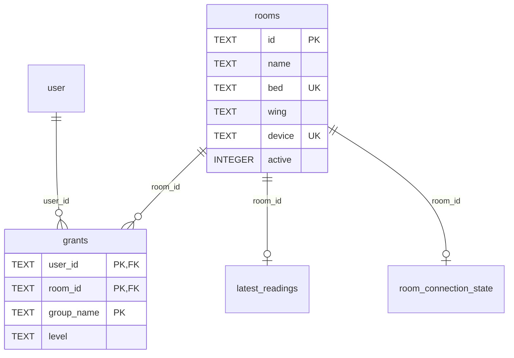

# Modelo de dados e persistência

## Visão geral

SQLite em `backend/data/samahi.sqlite` por padrão; aberto via `node:sqlite`. WAL, foreign keys habilitadas e `busy_timeout=5000`. O domínio grava JSON serializado em colunas TEXT; não existe servidor PostgreSQL. O código executado é a referência do DDL: `backend/core.mjs`.



O diagrama mostra somente relacionamentos com FK declarada no domínio. `user` pertence ao Better Auth. `commands` e `audit` referenciam usuários/quartos por valor, mas não declaram FK para esses campos.

## Dicionário do domínio

| Tabela | Chave/campos | Regras |
| --- | --- | --- |
| `rooms` | id PK; name, bed, wing, device, active | bed/device UNIQUE NOCASE; active inteiro 0/1; API recebe booleano e devolve inteiro |
| `grants` | PK(user_id, room_id, group_name); level | FK user/rooms ON DELETE CASCADE; quatro grupos; none/read/control; sensors/history sem control |
| `audit` | id INTEGER PK; at, actor, room_id nullable, action, detail | at ISO UTC; detail JSON; eventos globais usam room_id nulo |
| `latest_readings` | room_id PK/FK; received_at, payload | Última leitura aceita durante observação, JSON; não é série histórica de todas as amostras |
| `room_connection_state` | room_id PK/FK; state | online/offline/stale; evita repetir evento de transição a cada poll |
| `commands` | PK(actor, room_id, command_id); request, status, response nullable | request/response JSON; estados pending/confirmed/unconfirmed usados pelo código |

`rooms.id` na API: 1–64 caracteres `[a-z0-9-]`, imutável na edição. Nome/leito/ala/dispositivo são textos não vazios, aparados, de até 160 caracteres. Colisões de leito/dispositivo retornam 409; a mensagem de unicidade é genérica e não identifica necessariamente a coluna que colidiu.

### Tabelas da autenticação

Better Auth gerencia usuários, credenciais de conta, sessões, verificação e limitação de tentativas (`user`, `account`, `session`, `verification`, `rateLimit` na configuração instalada). O esquema é migrado pela biblioteca ao inicializar. Não há senha em texto simples na tabela própria de domínio; hashing é delegado ao Better Auth. O [guia oficial do banco](https://www.better-auth.com/docs/concepts/database) descreve o modelo da biblioteca; para inspecionar a instalação concreta use `sqlite_master`.

### Outros armazenamentos

| Local | Conteúdo | Sobrevive a quê? |
| --- | --- | --- |
| `backend/data/auth-secret` | Segredo gerado na primeira carga | Reinício; precisa acompanhar o banco no backup |
| `backend/data/node-red-lighting.json` | schedule, mode, intensity, lastPositive | Reinício/reset da instância persistente; gravação por arquivo temporário + rename |
| AsyncStorage nativo / localStorage web | chave `@samahi/preferences/v1`: version, backendUrl, dark, reduceMotion | Reabertura no mesmo dispositivo/origem; limpeza de dados ou mudança de origem perde preferências |
| Memória do cliente | Token, pendência, último painel carregado | Não persiste após encerrar/recarregar |
| Memória do simulador | Sensores, cenário, indicador, reconhecimento de gás | Não persiste após reiniciar processo |

A intensidade automática pode variar com o relógio depois de restaurar o arquivo; salvar a agenda não congela o período atual para sempre. Nenhum desses arquivos deve ser versionado com dados de execução.

## Integridade e evolução

As concessões são substituídas em transação; observações de estado e gás usam `BEGIN IMMEDIATE`; comandos possuem registro antes da chamada externa e atualização após ela. A transação SQLite não inclui execução remota no Node-RED. Uma queda entre envio e resposta exige reconciliação; não há transação distribuída.

O domínio atualmente cria tabelas de forma aditiva e define `PRAGMA user_version=1`. Uma mudança estrutural futura deve acrescentar migração versionada, teste de atualização e estratégia de recuperação, em vez de apagar o arquivo para “atualizar”. Better Auth mantém mecanismo próprio de migração.

## Inspeção local

DBeaver pode abrir o arquivo com driver SQLite; não é pgAdmin. Prefira conexão somente leitura e nunca exporte tabelas de sessão/credenciais para capturas. Consulta de inventário segura para entendimento estrutural:

```sql
SELECT name, sql FROM sqlite_master WHERE type = 'table' ORDER BY name;
PRAGMA user_version;
PRAGMA foreign_key_list(grants);
```

Histórico não possui retenção ou expurgo automáticos. A rota entrega apenas os últimos 100 eventos do quarto; isso não limita o tamanho do banco. [Backup, restauração e transferência](operacao.md).
